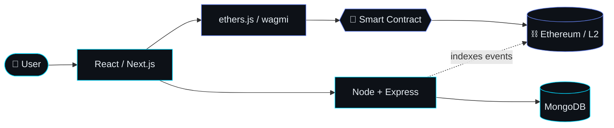

<div align="center">

# gm, I'm Mayur 👋

### Full-stack dev, learning Web3 one block at a time ⛓️


[](https://linkedin.com/in/mayur-bhil)
[](https://twitter.com/IamMayur_01)
[](mailto:mayurbhil47@gmail.com)


<br />

**⛓️ Drag to rotate · scroll to zoom ⛓️**
<br />
_My name, mined as a chain of 3D blocks, with Ethereum floating above it._

</div>

```stl
solid web3chain
facet normal 0.0 0.0 1.0
outer loop
vertex -14 -14 0
vertex 566 -14 0
vertex 566 54 0
endloop
endfacet
facet normal 0.0 0.0 1.0
outer loop
vertex -14 -14 0
vertex 566 54 0
vertex -14 54 0
endloop
endfacet
facet normal 1.0 0.0 0.0
outer loop
vertex 566 -14 -6
vertex 566 54 -6
vertex 566 54 0
endloop
endfacet
facet normal 1.0 0.0 0.0
outer loop
vertex 566 -14 -6
vertex 566 54 0
vertex 566 -14 0
endloop
endfacet
facet normal -1.0 0.0 0.0
outer loop
vertex -14 -14 -6
vertex -14 54 0
vertex -14 54 -6
endloop
endfacet
facet normal -1.0 0.0 0.0
outer loop
vertex -14 -14 -6
vertex -14 -14 0
vertex -14 54 0
endloop
endfacet
facet normal 0.0 1.0 0.0
outer loop
vertex -14 54 -6
vertex 566 54 0
vertex 566 54 -6
endloop
endfacet
facet normal 0.0 1.0 0.0
outer loop
vertex -14 54 -6
vertex -14 54 0
vertex 566 54 0
endloop
endfacet
facet normal 0.0 -1.0 0.0
outer loop
vertex -14 -14 -6
vertex 566 -14 -6
vertex 566 -14 0
endloop
endfacet
facet normal 0.0 -1.0 0.0
outer loop
vertex -14 -14 -6
vertex 566 -14 0
vertex -14 -14 0
endloop
endfacet
facet normal 0.0 0.0 1.0
outer loop
vertex 0 0 40
vertex 40 0 40
vertex 40 40 40
endloop
endfacet
facet normal 0.0 0.0 1.0
outer loop
vertex 0 0 40
vertex 40 40 40
vertex 0 40 40
endloop
endfacet
facet normal 1.0 0.0 0.0
outer loop
vertex 40 0 0
vertex 40 40 0
vertex 40 40 40
endloop
endfacet
facet normal 1.0 0.0 0.0
outer loop
vertex 40 0 0
vertex 40 40 40
vertex 40 0 40
endloop
endfacet
facet normal -1.0 0.0 0.0
outer loop
vertex 0 0 0
vertex 0 40 40
vertex 0 40 0
endloop
endfacet
facet normal -1.0 0.0 0.0
outer loop
vertex 0 0 0
vertex 0 0 40
vertex 0 40 40
endloop
endfacet
facet normal 0.0 1.0 0.0
outer loop
vertex 0 40 0
vertex 40 40 40
vertex 40 40 0
endloop
endfacet
facet normal 0.0 1.0 0.0
outer loop
vertex 0 40 0
vertex 0 40 40
vertex 40 40 40
endloop
endfacet
facet normal 0.0 -1.0 0.0
outer loop
vertex 0 0 0
vertex 40 0 0
vertex 40 0 40
endloop
endfacet
facet normal 0.0 -1.0 0.0
outer loop
vertex 0 0 0
vertex 40 0 40
vertex 0 0 40
endloop
endfacet
facet normal 0.0 0.0 1.0
outer loop
vertex 40 16 22
vertex 64 16 22
vertex 64 24 22
endloop
endfacet
facet normal 0.0 0.0 1.0
outer loop
vertex 40 16 22
vertex 64 24 22
vertex 40 24 22
endloop
endfacet
facet normal 1.0 0.0 0.0
outer loop
vertex 64 16 14
vertex 64 24 14
vertex 64 24 22
endloop
endfacet
facet normal 1.0 0.0 0.0
outer loop
vertex 64 16 14
vertex 64 24 22
vertex 64 16 22
endloop
endfacet
facet normal 0.0 1.0 0.0
outer loop
vertex 40 24 14
vertex 64 24 22
vertex 64 24 14
endloop
endfacet
facet normal 0.0 1.0 0.0
outer loop
vertex 40 24 14
vertex 40 24 22
vertex 64 24 22
endloop
endfacet
facet normal 0.0 -1.0 0.0
outer loop
vertex 40 16 14
vertex 64 16 14
vertex 64 16 22
endloop
endfacet
facet normal 0.0 -1.0 0.0
outer loop
vertex 40 16 14
vertex 64 16 22
vertex 40 16 22
endloop
endfacet
facet normal 0.0 0.0 1.0
outer loop
vertex 10 26 44
vertex 14 26 44
vertex 14 30 44
endloop
endfacet
facet normal 0.0 0.0 1.0
outer loop
vertex 10 26 44
vertex 14 30 44
vertex 10 30 44
endloop
endfacet
facet normal -1.0 0.0 0.0
outer loop
vertex 10 26 40
vertex 10 30 44
vertex 10 30 40
endloop
endfacet
facet normal -1.0 0.0 0.0
outer loop
vertex 10 26 40
vertex 10 26 44
vertex 10 30 44
endloop
endfacet
facet normal 0.0 0.0 1.0
outer loop
vertex 26 14 44
vertex 30 14 44
vertex 30 18 44
endloop
endfacet
facet normal 0.0 0.0 1.0
outer loop
vertex 26 14 44
vertex 30 18 44
vertex 26 18 44
endloop
endfacet
facet normal 1.0 0.0 0.0
outer loop
vertex 30 14 40
vertex 30 18 40
vertex 30 18 44
endloop
endfacet
facet normal 1.0 0.0 0.0
outer loop
vertex 30 14 40
vertex 30 18 44
vertex 30 14 44
endloop
endfacet
facet normal -1.0 0.0 0.0
outer loop
vertex 26 14 40
vertex 26 18 44
vertex 26 18 40
endloop
endfacet
facet normal -1.0 0.0 0.0
outer loop
vertex 26 14 40
vertex 26 14 44
vertex 26 18 44
endloop
endfacet
facet normal 0.0 0.0 1.0
outer loop
vertex 26 30 44
vertex 30 30 44
vertex 30 34 44
endloop
endfacet
facet normal 0.0 0.0 1.0
outer loop
vertex 26 30 44
vertex 30 34 44
vertex 26 34 44
endloop
endfacet
facet normal 1.0 0.0 0.0
outer loop
vertex 30 30 40
vertex 30 34 40
vertex 30 34 44
endloop
endfacet
facet normal 1.0 0.0 0.0
outer loop
vertex 30 30 40
vertex 30 34 44
vertex 30 30 44
endloop
endfacet
facet normal -1.0 0.0 0.0
outer loop
vertex 26 30 40
vertex 26 34 44
vertex 26 34 40
endloop
endfacet
facet normal -1.0 0.0 0.0
outer loop
vertex 26 30 40
vertex 26 30 44
vertex 26 34 44
endloop
endfacet
facet normal 0.0 1.0 0.0
outer loop
vertex 26 34 40
vertex 30 34 44
vertex 30 34 40
endloop
endfacet
facet normal 0.0 1.0 0.0
outer loop
vertex 26 34 40
vertex 26 34 44
vertex 30 34 44
endloop
endfacet
facet normal 0.0 0.0 1.0
outer loop
vertex 10 14 44
vertex 14 14 44
vertex 14 18 44
endloop
endfacet
facet normal 0.0 0.0 1.0
outer loop
vertex 10 14 44
vertex 14 18 44
vertex 10 18 44
endloop
endfacet
facet normal 1.0 0.0 0.0
outer loop
vertex 14 14 40
vertex 14 18 40
vertex 14 18 44
endloop
endfacet
facet normal 1.0 0.0 0.0
outer loop
vertex 14 14 40
vertex 14 18 44
vertex 14 14 44
endloop
endfacet
facet normal -1.0 0.0 0.0
outer loop
vertex 10 14 40
vertex 10 18 44
vertex 10 18 40
endloop
endfacet
facet normal -1.0 0.0 0.0
outer loop
vertex 10 14 40
vertex 10 14 44
vertex 10 18 44
endloop
endfacet
facet normal 0.0 0.0 1.0
outer loop
vertex 10 30 44
vertex 14 30 44
vertex 14 34 44
endloop
endfacet
facet normal 0.0 0.0 1.0
outer loop
vertex 10 30 44
vertex 14 34 44
vertex 10 34 44
endloop
endfacet
facet normal 1.0 0.0 0.0
outer loop
vertex 14 30 40
vertex 14 34 40
vertex 14 34 44
endloop
endfacet
facet normal 1.0 0.0 0.0
outer loop
vertex 14 30 40
vertex 14 34 44
vertex 14 30 44
endloop
endfacet
facet normal -1.0 0.0 0.0
outer loop
vertex 10 30 40
vertex 10 34 44
vertex 10 34 40
endloop
endfacet
facet normal -1.0 0.0 0.0
outer loop
vertex 10 30 40
vertex 10 30 44
vertex 10 34 44
endloop
endfacet
facet normal 0.0 1.0 0.0
outer loop
vertex 10 34 40
vertex 14 34 44
vertex 14 34 40
endloop
endfacet
facet normal 0.0 1.0 0.0
outer loop
vertex 10 34 40
vertex 10 34 44
vertex 14 34 44
endloop
endfacet
facet normal 0.0 0.0 1.0
outer loop
vertex 22 26 44
vertex 26 26 44
vertex 26 30 44
endloop
endfacet
facet normal 0.0 0.0 1.0
outer loop
vertex 22 26 44
vertex 26 30 44
vertex 22 30 44
endloop
endfacet
facet normal -1.0 0.0 0.0
outer loop
vertex 22 26 40
vertex 22 30 44
vertex 22 30 40
endloop
endfacet
facet normal -1.0 0.0 0.0
outer loop
vertex 22 26 40
vertex 22 26 44
vertex 22 30 44
endloop
endfacet
facet normal 0.0 1.0 0.0
outer loop
vertex 22 30 40
vertex 26 30 44
vertex 26 30 40
endloop
endfacet
facet normal 0.0 1.0 0.0
outer loop
vertex 22 30 40
vertex 22 30 44
vertex 26 30 44
endloop
endfacet
facet normal 0.0 -1.0 0.0
outer loop
vertex 22 26 40
vertex 26 26 40
vertex 26 26 44
endloop
endfacet
facet normal 0.0 -1.0 0.0
outer loop
vertex 22 26 40
vertex 26 26 44
vertex 22 26 44
endloop
endfacet
facet normal 0.0 0.0 1.0
outer loop
vertex 26 18 44
vertex 30 18 44
vertex 30 22 44
endloop
endfacet
facet normal 0.0 0.0 1.0
outer loop
vertex 26 18 44
vertex 30 22 44
vertex 26 22 44
endloop
endfacet
facet normal 1.0 0.0 0.0
outer loop
vertex 30 18 40
vertex 30 22 40
vertex 30 22 44
endloop
endfacet
facet normal 1.0 0.0 0.0
outer loop
vertex 30 18 40
vertex 30 22 44
vertex 30 18 44
endloop
endfacet
facet normal -1.0 0.0 0.0
outer loop
vertex 26 18 40
vertex 26 22 44
vertex 26 22 40
endloop
endfacet
facet normal -1.0 0.0 0.0
outer loop
vertex 26 18 40
vertex 26 18 44
vertex 26 22 44
endloop
endfacet
facet normal 0.0 0.0 1.0
outer loop
vertex 14 26 44
vertex 18 26 44
vertex 18 30 44
endloop
endfacet
facet normal 0.0 0.0 1.0
outer loop
vertex 14 26 44
vertex 18 30 44
vertex 14 30 44
endloop
endfacet
facet normal 1.0 0.0 0.0
outer loop
vertex 18 26 40
vertex 18 30 40
vertex 18 30 44
endloop
endfacet
facet normal 1.0 0.0 0.0
outer loop
vertex 18 26 40
vertex 18 30 44
vertex 18 26 44
endloop
endfacet
facet normal 0.0 1.0 0.0
outer loop
vertex 14 30 40
vertex 18 30 44
vertex 18 30 40
endloop
endfacet
facet normal 0.0 1.0 0.0
outer loop
vertex 14 30 40
vertex 14 30 44
vertex 18 30 44
endloop
endfacet
facet normal 0.0 -1.0 0.0
outer loop
vertex 14 26 40
vertex 18 26 40
vertex 18 26 44
endloop
endfacet
facet normal 0.0 -1.0 0.0
outer loop
vertex 14 26 40
vertex 18 26 44
vertex 14 26 44
endloop
endfacet
facet normal 0.0 0.0 1.0
outer loop
vertex 10 18 44
vertex 14 18 44
vertex 14 22 44
endloop
endfacet
facet normal 0.0 0.0 1.0
outer loop
vertex 10 18 44
vertex 14 22 44
vertex 10 22 44
endloop
endfacet
facet normal 1.0 0.0 0.0
outer loop
vertex 14 18 40
vertex 14 22 40
vertex 14 22 44
endloop
endfacet
facet normal 1.0 0.0 0.0
outer loop
vertex 14 18 40
vertex 14 22 44
vertex 14 18 44
endloop
endfacet
facet normal -1.0 0.0 0.0
outer loop
vertex 10 18 40
vertex 10 22 44
vertex 10 22 40
endloop
endfacet
facet normal -1.0 0.0 0.0
outer loop
vertex 10 18 40
vertex 10 18 44
vertex 10 22 44
endloop
endfacet
facet normal 0.0 0.0 1.0
outer loop
vertex 26 6 44
vertex 30 6 44
vertex 30 10 44
endloop
endfacet
facet normal 0.0 0.0 1.0
outer loop
vertex 26 6 44
vertex 30 10 44
vertex 26 10 44
endloop
endfacet
facet normal 1.0 0.0 0.0
outer loop
vertex 30 6 40
vertex 30 10 40
vertex 30 10 44
endloop
endfacet
facet normal 1.0 0.0 0.0
outer loop
vertex 30 6 40
vertex 30 10 44
vertex 30 6 44
endloop
endfacet
facet normal -1.0 0.0 0.0
outer loop
vertex 26 6 40
vertex 26 10 44
vertex 26 10 40
endloop
endfacet
facet normal -1.0 0.0 0.0
outer loop
vertex 26 6 40
vertex 26 6 44
vertex 26 10 44
endloop
endfacet
facet normal 0.0 -1.0 0.0
outer loop
vertex 26 6 40
vertex 30 6 40
vertex 30 6 44
endloop
endfacet
facet normal 0.0 -1.0 0.0
outer loop
vertex 26 6 40
vertex 30 6 44
vertex 26 6 44
endloop
endfacet
facet normal 0.0 0.0 1.0
outer loop
vertex 26 22 44
vertex 30 22 44
vertex 30 26 44
endloop
endfacet
facet normal 0.0 0.0 1.0
outer loop
vertex 26 22 44
vertex 30 26 44
vertex 26 26 44
endloop
endfacet
facet normal 1.0 0.0 0.0
outer loop
vertex 30 22 40
vertex 30 26 40
vertex 30 26 44
endloop
endfacet
facet normal 1.0 0.0 0.0
outer loop
vertex 30 22 40
vertex 30 26 44
vertex 30 22 44
endloop
endfacet
facet normal -1.0 0.0 0.0
outer loop
vertex 26 22 40
vertex 26 26 44
vertex 26 26 40
endloop
endfacet
facet normal -1.0 0.0 0.0
outer loop
vertex 26 22 40
vertex 26 22 44
vertex 26 26 44
endloop
endfacet
facet normal 0.0 0.0 1.0
outer loop
vertex 10 6 44
vertex 14 6 44
vertex 14 10 44
endloop
endfacet
facet normal 0.0 0.0 1.0
outer loop
vertex 10 6 44
vertex 14 10 44
vertex 10 10 44
endloop
endfacet
facet normal 1.0 0.0 0.0
outer loop
vertex 14 6 40
vertex 14 10 40
vertex 14 10 44
endloop
endfacet
facet normal 1.0 0.0 0.0
outer loop
vertex 14 6 40
vertex 14 10 44
vertex 14 6 44
endloop
endfacet
facet normal -1.0 0.0 0.0
outer loop
vertex 10 6 40
vertex 10 10 44
vertex 10 10 40
endloop
endfacet
facet normal -1.0 0.0 0.0
outer loop
vertex 10 6 40
vertex 10 6 44
vertex 10 10 44
endloop
endfacet
facet normal 0.0 -1.0 0.0
outer loop
vertex 10 6 40
vertex 14 6 40
vertex 14 6 44
endloop
endfacet
facet normal 0.0 -1.0 0.0
outer loop
vertex 10 6 40
vertex 14 6 44
vertex 10 6 44
endloop
endfacet
facet normal 0.0 0.0 1.0
outer loop
vertex 18 18 44
vertex 22 18 44
vertex 22 22 44
endloop
endfacet
facet normal 0.0 0.0 1.0
outer loop
vertex 18 18 44
vertex 22 22 44
vertex 18 22 44
endloop
endfacet
facet normal 1.0 0.0 0.0
outer loop
vertex 22 18 40
vertex 22 22 40
vertex 22 22 44
endloop
endfacet
facet normal 1.0 0.0 0.0
outer loop
vertex 22 18 40
vertex 22 22 44
vertex 22 18 44
endloop
endfacet
facet normal -1.0 0.0 0.0
outer loop
vertex 18 18 40
vertex 18 22 44
vertex 18 22 40
endloop
endfacet
facet normal -1.0 0.0 0.0
outer loop
vertex 18 18 40
vertex 18 18 44
vertex 18 22 44
endloop
endfacet
facet normal 0.0 -1.0 0.0
outer loop
vertex 18 18 40
vertex 22 18 40
vertex 22 18 44
endloop
endfacet
facet normal 0.0 -1.0 0.0
outer loop
vertex 18 18 40
vertex 22 18 44
vertex 18 18 44
endloop
endfacet
facet normal 0.0 0.0 1.0
outer loop
vertex 10 22 44
vertex 14 22 44
vertex 14 26 44
endloop
endfacet
facet normal 0.0 0.0 1.0
outer loop
vertex 10 22 44
vertex 14 26 44
vertex 10 26 44
endloop
endfacet
facet normal 1.0 0.0 0.0
outer loop
vertex 14 22 40
vertex 14 26 40
vertex 14 26 44
endloop
endfacet
facet normal 1.0 0.0 0.0
outer loop
vertex 14 22 40
vertex 14 26 44
vertex 14 22 44
endloop
endfacet
facet normal -1.0 0.0 0.0
outer loop
vertex 10 22 40
vertex 10 26 44
vertex 10 26 40
endloop
endfacet
facet normal -1.0 0.0 0.0
outer loop
vertex 10 22 40
vertex 10 22 44
vertex 10 26 44
endloop
endfacet
facet normal 0.0 0.0 1.0
outer loop
vertex 26 10 44
vertex 30 10 44
vertex 30 14 44
endloop
endfacet
facet normal 0.0 0.0 1.0
outer loop
vertex 26 10 44
vertex 30 14 44
vertex 26 14 44
endloop
endfacet
facet normal 1.0 0.0 0.0
outer loop
vertex 30 10 40
vertex 30 14 40
vertex 30 14 44
endloop
endfacet
facet normal 1.0 0.0 0.0
outer loop
vertex 30 10 40
vertex 30 14 44
vertex 30 10 44
endloop
endfacet
facet normal -1.0 0.0 0.0
outer loop
vertex 26 10 40
vertex 26 14 44
vertex 26 14 40
endloop
endfacet
facet normal -1.0 0.0 0.0
outer loop
vertex 26 10 40
vertex 26 10 44
vertex 26 14 44
endloop
endfacet
facet normal 0.0 0.0 1.0
outer loop
vertex 10 10 44
vertex 14 10 44
vertex 14 14 44
endloop
endfacet
facet normal 0.0 0.0 1.0
outer loop
vertex 10 10 44
vertex 14 14 44
vertex 10 14 44
endloop
endfacet
facet normal 1.0 0.0 0.0
outer loop
vertex 14 10 40
vertex 14 14 40
vertex 14 14 44
endloop
endfacet
facet normal 1.0 0.0 0.0
outer loop
vertex 14 10 40
vertex 14 14 44
vertex 14 10 44
endloop
endfacet
facet normal -1.0 0.0 0.0
outer loop
vertex 10 10 40
vertex 10 14 44
vertex 10 14 40
endloop
endfacet
facet normal -1.0 0.0 0.0
outer loop
vertex 10 10 40
vertex 10 10 44
vertex 10 14 44
endloop
endfacet
facet normal 0.0 0.0 1.0
outer loop
vertex 18 22 44
vertex 22 22 44
vertex 22 26 44
endloop
endfacet
facet normal 0.0 0.0 1.0
outer loop
vertex 18 22 44
vertex 22 26 44
vertex 18 26 44
endloop
endfacet
facet normal 1.0 0.0 0.0
outer loop
vertex 22 22 40
vertex 22 26 40
vertex 22 26 44
endloop
endfacet
facet normal 1.0 0.0 0.0
outer loop
vertex 22 22 40
vertex 22 26 44
vertex 22 22 44
endloop
endfacet
facet normal -1.0 0.0 0.0
outer loop
vertex 18 22 40
vertex 18 26 44
vertex 18 26 40
endloop
endfacet
facet normal -1.0 0.0 0.0
outer loop
vertex 18 22 40
vertex 18 22 44
vertex 18 26 44
endloop
endfacet
facet normal 0.0 1.0 0.0
outer loop
vertex 18 26 40
vertex 22 26 44
vertex 22 26 40
endloop
endfacet
facet normal 0.0 1.0 0.0
outer loop
vertex 18 26 40
vertex 18 26 44
vertex 22 26 44
endloop
endfacet
facet normal 0.0 0.0 1.0
outer loop
vertex 26 26 44
vertex 30 26 44
vertex 30 30 44
endloop
endfacet
facet normal 0.0 0.0 1.0
outer loop
vertex 26 26 44
vertex 30 30 44
vertex 26 30 44
endloop
endfacet
facet normal 1.0 0.0 0.0
outer loop
vertex 30 26 40
vertex 30 30 40
vertex 30 30 44
endloop
endfacet
facet normal 1.0 0.0 0.0
outer loop
vertex 30 26 40
vertex 30 30 44
vertex 30 26 44
endloop
endfacet
facet normal 0.0 0.0 1.0
outer loop
vertex 64 0 40
vertex 104 0 40
vertex 104 40 40
endloop
endfacet
facet normal 0.0 0.0 1.0
outer loop
vertex 64 0 40
vertex 104 40 40
vertex 64 40 40
endloop
endfacet
facet normal 1.0 0.0 0.0
outer loop
vertex 104 0 0
vertex 104 40 0
vertex 104 40 40
endloop
endfacet
facet normal 1.0 0.0 0.0
outer loop
vertex 104 0 0
vertex 104 40 40
vertex 104 0 40
endloop
endfacet
facet normal -1.0 0.0 0.0
outer loop
vertex 64 0 0
vertex 64 40 40
vertex 64 40 0
endloop
endfacet
facet normal -1.0 0.0 0.0
outer loop
vertex 64 0 0
vertex 64 0 40
vertex 64 40 40
endloop
endfacet
facet normal 0.0 1.0 0.0
outer loop
vertex 64 40 0
vertex 104 40 40
vertex 104 40 0
endloop
endfacet
facet normal 0.0 1.0 0.0
outer loop
vertex 64 40 0
vertex 64 40 40
vertex 104 40 40
endloop
endfacet
facet normal 0.0 -1.0 0.0
outer loop
vertex 64 0 0
vertex 104 0 0
vertex 104 0 40
endloop
endfacet
facet normal 0.0 -1.0 0.0
outer loop
vertex 64 0 0
vertex 104 0 40
vertex 64 0 40
endloop
endfacet
facet normal 0.0 0.0 1.0
outer loop
vertex 104 16 22
vertex 128 16 22
vertex 128 24 22
endloop
endfacet
facet normal 0.0 0.0 1.0
outer loop
vertex 104 16 22
vertex 128 24 22
vertex 104 24 22
endloop
endfacet
facet normal 1.0 0.0 0.0
outer loop
vertex 128 16 14
vertex 128 24 14
vertex 128 24 22
endloop
endfacet
facet normal 1.0 0.0 0.0
outer loop
vertex 128 16 14
vertex 128 24 22
vertex 128 16 22
endloop
endfacet
facet normal 0.0 1.0 0.0
outer loop
vertex 104 24 14
vertex 128 24 22
vertex 128 24 14
endloop
endfacet
facet normal 0.0 1.0 0.0
outer loop
vertex 104 24 14
vertex 104 24 22
vertex 128 24 22
endloop
endfacet
facet normal 0.0 -1.0 0.0
outer loop
vertex 104 16 14
vertex 128 16 14
vertex 128 16 22
endloop
endfacet
facet normal 0.0 -1.0 0.0
outer loop
vertex 104 16 14
vertex 128 16 22
vertex 104 16 22
endloop
endfacet
facet normal 0.0 0.0 1.0
outer loop
vertex 74 26 44
vertex 78 26 44
vertex 78 30 44
endloop
endfacet
facet normal 0.0 0.0 1.0
outer loop
vertex 74 26 44
vertex 78 30 44
vertex 74 30 44
endloop
endfacet
facet normal 1.0 0.0 0.0
outer loop
vertex 78 26 40
vertex 78 30 40
vertex 78 30 44
endloop
endfacet
facet normal 1.0 0.0 0.0
outer loop
vertex 78 26 40
vertex 78 30 44
vertex 78 26 44
endloop
endfacet
facet normal -1.0 0.0 0.0
outer loop
vertex 74 26 40
vertex 74 30 44
vertex 74 30 40
endloop
endfacet
facet normal -1.0 0.0 0.0
outer loop
vertex 74 26 40
vertex 74 26 44
vertex 74 30 44
endloop
endfacet
facet normal 0.0 1.0 0.0
outer loop
vertex 74 30 40
vertex 78 30 44
vertex 78 30 40
endloop
endfacet
facet normal 0.0 1.0 0.0
outer loop
vertex 74 30 40
vertex 74 30 44
vertex 78 30 44
endloop
endfacet
facet normal 0.0 0.0 1.0
outer loop
vertex 78 18 44
vertex 82 18 44
vertex 82 22 44
endloop
endfacet
facet normal 0.0 0.0 1.0
outer loop
vertex 78 18 44
vertex 82 22 44
vertex 78 22 44
endloop
endfacet
facet normal 0.0 1.0 0.0
outer loop
vertex 78 22 40
vertex 82 22 44
vertex 82 22 40
endloop
endfacet
facet normal 0.0 1.0 0.0
outer loop
vertex 78 22 40
vertex 78 22 44
vertex 82 22 44
endloop
endfacet
facet normal 0.0 -1.0 0.0
outer loop
vertex 78 18 40
vertex 82 18 40
vertex 82 18 44
endloop
endfacet
facet normal 0.0 -1.0 0.0
outer loop
vertex 78 18 40
vertex 82 18 44
vertex 78 18 44
endloop
endfacet
facet normal 0.0 0.0 1.0
outer loop
vertex 90 14 44
vertex 94 14 44
vertex 94 18 44
endloop
endfacet
facet normal 0.0 0.0 1.0
outer loop
vertex 90 14 44
vertex 94 18 44
vertex 90 18 44
endloop
endfacet
facet normal 1.0 0.0 0.0
outer loop
vertex 94 14 40
vertex 94 18 40
vertex 94 18 44
endloop
endfacet
facet normal 1.0 0.0 0.0
outer loop
vertex 94 14 40
vertex 94 18 44
vertex 94 14 44
endloop
endfacet
facet normal -1.0 0.0 0.0
outer loop
vertex 90 14 40
vertex 90 18 44
vertex 90 18 40
endloop
endfacet
facet normal -1.0 0.0 0.0
outer loop
vertex 90 14 40
vertex 90 14 44
vertex 90 18 44
endloop
endfacet
facet normal 0.0 0.0 1.0
outer loop
vertex 74 14 44
vertex 78 14 44
vertex 78 18 44
endloop
endfacet
facet normal 0.0 0.0 1.0
outer loop
vertex 74 14 44
vertex 78 18 44
vertex 74 18 44
endloop
endfacet
facet normal 1.0 0.0 0.0
outer loop
vertex 78 14 40
vertex 78 18 40
vertex 78 18 44
endloop
endfacet
facet normal 1.0 0.0 0.0
outer loop
vertex 78 14 40
vertex 78 18 44
vertex 78 14 44
endloop
endfacet
facet normal -1.0 0.0 0.0
outer loop
vertex 74 14 40
vertex 74 18 44
vertex 74 18 40
endloop
endfacet
facet normal -1.0 0.0 0.0
outer loop
vertex 74 14 40
vertex 74 14 44
vertex 74 18 44
endloop
endfacet
facet normal 0.0 0.0 1.0
outer loop
vertex 90 18 44
vertex 94 18 44
vertex 94 22 44
endloop
endfacet
facet normal 0.0 0.0 1.0
outer loop
vertex 90 18 44
vertex 94 22 44
vertex 90 22 44
endloop
endfacet
facet normal 1.0 0.0 0.0
outer loop
vertex 94 18 40
vertex 94 22 40
vertex 94 22 44
endloop
endfacet
facet normal 1.0 0.0 0.0
outer loop
vertex 94 18 40
vertex 94 22 44
vertex 94 18 44
endloop
endfacet
facet normal 0.0 0.0 1.0
outer loop
vertex 74 18 44
vertex 78 18 44
vertex 78 22 44
endloop
endfacet
facet normal 0.0 0.0 1.0
outer loop
vertex 74 18 44
vertex 78 22 44
vertex 74 22 44
endloop
endfacet
facet normal -1.0 0.0 0.0
outer loop
vertex 74 18 40
vertex 74 22 44
vertex 74 22 40
endloop
endfacet
facet normal -1.0 0.0 0.0
outer loop
vertex 74 18 40
vertex 74 18 44
vertex 74 22 44
endloop
endfacet
facet normal 0.0 0.0 1.0
outer loop
vertex 82 30 44
vertex 86 30 44
vertex 86 34 44
endloop
endfacet
facet normal 0.0 0.0 1.0
outer loop
vertex 82 30 44
vertex 86 34 44
vertex 82 34 44
endloop
endfacet
facet normal 0.0 1.0 0.0
outer loop
vertex 82 34 40
vertex 86 34 44
vertex 86 34 40
endloop
endfacet
facet normal 0.0 1.0 0.0
outer loop
vertex 82 34 40
vertex 82 34 44
vertex 86 34 44
endloop
endfacet
facet normal 0.0 -1.0 0.0
outer loop
vertex 82 30 40
vertex 86 30 40
vertex 86 30 44
endloop
endfacet
facet normal 0.0 -1.0 0.0
outer loop
vertex 82 30 40
vertex 86 30 44
vertex 82 30 44
endloop
endfacet
facet normal 0.0 0.0 1.0
outer loop
vertex 90 6 44
vertex 94 6 44
vertex 94 10 44
endloop
endfacet
facet normal 0.0 0.0 1.0
outer loop
vertex 90 6 44
vertex 94 10 44
vertex 90 10 44
endloop
endfacet
facet normal 1.0 0.0 0.0
outer loop
vertex 94 6 40
vertex 94 10 40
vertex 94 10 44
endloop
endfacet
facet normal 1.0 0.0 0.0
outer loop
vertex 94 6 40
vertex 94 10 44
vertex 94 6 44
endloop
endfacet
facet normal -1.0 0.0 0.0
outer loop
vertex 90 6 40
vertex 90 10 44
vertex 90 10 40
endloop
endfacet
facet normal -1.0 0.0 0.0
outer loop
vertex 90 6 40
vertex 90 6 44
vertex 90 10 44
endloop
endfacet
facet normal 0.0 -1.0 0.0
outer loop
vertex 90 6 40
vertex 94 6 40
vertex 94 6 44
endloop
endfacet
facet normal 0.0 -1.0 0.0
outer loop
vertex 90 6 40
vertex 94 6 44
vertex 90 6 44
endloop
endfacet
facet normal 0.0 0.0 1.0
outer loop
vertex 90 22 44
vertex 94 22 44
vertex 94 26 44
endloop
endfacet
facet normal 0.0 0.0 1.0
outer loop
vertex 90 22 44
vertex 94 26 44
vertex 90 26 44
endloop
endfacet
facet normal 1.0 0.0 0.0
outer loop
vertex 94 22 40
vertex 94 26 40
vertex 94 26 44
endloop
endfacet
facet normal 1.0 0.0 0.0
outer loop
vertex 94 22 40
vertex 94 26 44
vertex 94 22 44
endloop
endfacet
facet normal -1.0 0.0 0.0
outer loop
vertex 90 22 40
vertex 90 26 44
vertex 90 26 40
endloop
endfacet
facet normal -1.0 0.0 0.0
outer loop
vertex 90 22 40
vertex 90 22 44
vertex 90 26 44
endloop
endfacet
facet normal 0.0 0.0 1.0
outer loop
vertex 86 30 44
vertex 90 30 44
vertex 90 34 44
endloop
endfacet
facet normal 0.0 0.0 1.0
outer loop
vertex 86 30 44
vertex 90 34 44
vertex 86 34 44
endloop
endfacet
facet normal 1.0 0.0 0.0
outer loop
vertex 90 30 40
vertex 90 34 40
vertex 90 34 44
endloop
endfacet
facet normal 1.0 0.0 0.0
outer loop
vertex 90 30 40
vertex 90 34 44
vertex 90 30 44
endloop
endfacet
facet normal 0.0 1.0 0.0
outer loop
vertex 86 34 40
vertex 90 34 44
vertex 90 34 40
endloop
endfacet
facet normal 0.0 1.0 0.0
outer loop
vertex 86 34 40
vertex 86 34 44
vertex 90 34 44
endloop
endfacet
facet normal 0.0 -1.0 0.0
outer loop
vertex 86 30 40
vertex 90 30 40
vertex 90 30 44
endloop
endfacet
facet normal 0.0 -1.0 0.0
outer loop
vertex 86 30 40
vertex 90 30 44
vertex 86 30 44
endloop
endfacet
facet normal 0.0 0.0 1.0
outer loop
vertex 82 18 44
vertex 86 18 44
vertex 86 22 44
endloop
endfacet
facet normal 0.0 0.0 1.0
outer loop
vertex 82 18 44
vertex 86 22 44
vertex 82 22 44
endloop
endfacet
facet normal 0.0 1.0 0.0
outer loop
vertex 82 22 40
vertex 86 22 44
vertex 86 22 40
endloop
endfacet
facet normal 0.0 1.0 0.0
outer loop
vertex 82 22 40
vertex 82 22 44
vertex 86 22 44
endloop
endfacet
facet normal 0.0 -1.0 0.0
outer loop
vertex 82 18 40
vertex 86 18 40
vertex 86 18 44
endloop
endfacet
facet normal 0.0 -1.0 0.0
outer loop
vertex 82 18 40
vertex 86 18 44
vertex 82 18 44
endloop
endfacet
facet normal 0.0 0.0 1.0
outer loop
vertex 74 6 44
vertex 78 6 44
vertex 78 10 44
endloop
endfacet
facet normal 0.0 0.0 1.0
outer loop
vertex 74 6 44
vertex 78 10 44
vertex 74 10 44
endloop
endfacet
facet normal 1.0 0.0 0.0
outer loop
vertex 78 6 40
vertex 78 10 40
vertex 78 10 44
endloop
endfacet
facet normal 1.0 0.0 0.0
outer loop
vertex 78 6 40
vertex 78 10 44
vertex 78 6 44
endloop
endfacet
facet normal -1.0 0.0 0.0
outer loop
vertex 74 6 40
vertex 74 10 44
vertex 74 10 40
endloop
endfacet
facet normal -1.0 0.0 0.0
outer loop
vertex 74 6 40
vertex 74 6 44
vertex 74 10 44
endloop
endfacet
facet normal 0.0 -1.0 0.0
outer loop
vertex 74 6 40
vertex 78 6 40
vertex 78 6 44
endloop
endfacet
facet normal 0.0 -1.0 0.0
outer loop
vertex 74 6 40
vertex 78 6 44
vertex 74 6 44
endloop
endfacet
facet normal 0.0 0.0 1.0
outer loop
vertex 74 22 44
vertex 78 22 44
vertex 78 26 44
endloop
endfacet
facet normal 0.0 0.0 1.0
outer loop
vertex 74 22 44
vertex 78 26 44
vertex 74 26 44
endloop
endfacet
facet normal 1.0 0.0 0.0
outer loop
vertex 78 22 40
vertex 78 26 40
vertex 78 26 44
endloop
endfacet
facet normal 1.0 0.0 0.0
outer loop
vertex 78 22 40
vertex 78 26 44
vertex 78 22 44
endloop
endfacet
facet normal -1.0 0.0 0.0
outer loop
vertex 74 22 40
vertex 74 26 44
vertex 74 26 40
endloop
endfacet
facet normal -1.0 0.0 0.0
outer loop
vertex 74 22 40
vertex 74 22 44
vertex 74 26 44
endloop
endfacet
facet normal 0.0 0.0 1.0
outer loop
vertex 86 18 44
vertex 90 18 44
vertex 90 22 44
endloop
endfacet
facet normal 0.0 0.0 1.0
outer loop
vertex 86 18 44
vertex 90 22 44
vertex 86 22 44
endloop
endfacet
facet normal 0.0 1.0 0.0
outer loop
vertex 86 22 40
vertex 90 22 44
vertex 90 22 40
endloop
endfacet
facet normal 0.0 1.0 0.0
outer loop
vertex 86 22 40
vertex 86 22 44
vertex 90 22 44
endloop
endfacet
facet normal 0.0 -1.0 0.0
outer loop
vertex 86 18 40
vertex 90 18 40
vertex 90 18 44
endloop
endfacet
facet normal 0.0 -1.0 0.0
outer loop
vertex 86 18 40
vertex 90 18 44
vertex 86 18 44
endloop
endfacet
facet normal 0.0 0.0 1.0
outer loop
vertex 90 10 44
vertex 94 10 44
vertex 94 14 44
endloop
endfacet
facet normal 0.0 0.0 1.0
outer loop
vertex 90 10 44
vertex 94 14 44
vertex 90 14 44
endloop
endfacet
facet normal 1.0 0.0 0.0
outer loop
vertex 94 10 40
vertex 94 14 40
vertex 94 14 44
endloop
endfacet
facet normal 1.0 0.0 0.0
outer loop
vertex 94 10 40
vertex 94 14 44
vertex 94 10 44
endloop
endfacet
facet normal -1.0 0.0 0.0
outer loop
vertex 90 10 40
vertex 90 14 44
vertex 90 14 40
endloop
endfacet
facet normal -1.0 0.0 0.0
outer loop
vertex 90 10 40
vertex 90 10 44
vertex 90 14 44
endloop
endfacet
facet normal 0.0 0.0 1.0
outer loop
vertex 74 10 44
vertex 78 10 44
vertex 78 14 44
endloop
endfacet
facet normal 0.0 0.0 1.0
outer loop
vertex 74 10 44
vertex 78 14 44
vertex 74 14 44
endloop
endfacet
facet normal 1.0 0.0 0.0
outer loop
vertex 78 10 40
vertex 78 14 40
vertex 78 14 44
endloop
endfacet
facet normal 1.0 0.0 0.0
outer loop
vertex 78 10 40
vertex 78 14 44
vertex 78 10 44
endloop
endfacet
facet normal -1.0 0.0 0.0
outer loop
vertex 74 10 40
vertex 74 14 44
vertex 74 14 40
endloop
endfacet
facet normal -1.0 0.0 0.0
outer loop
vertex 74 10 40
vertex 74 10 44
vertex 74 14 44
endloop
endfacet
facet normal 0.0 0.0 1.0
outer loop
vertex 78 30 44
vertex 82 30 44
vertex 82 34 44
endloop
endfacet
facet normal 0.0 0.0 1.0
outer loop
vertex 78 30 44
vertex 82 34 44
vertex 78 34 44
endloop
endfacet
facet normal -1.0 0.0 0.0
outer loop
vertex 78 30 40
vertex 78 34 44
vertex 78 34 40
endloop
endfacet
facet normal -1.0 0.0 0.0
outer loop
vertex 78 30 40
vertex 78 30 44
vertex 78 34 44
endloop
endfacet
facet normal 0.0 1.0 0.0
outer loop
vertex 78 34 40
vertex 82 34 44
vertex 82 34 40
endloop
endfacet
facet normal 0.0 1.0 0.0
outer loop
vertex 78 34 40
vertex 78 34 44
vertex 82 34 44
endloop
endfacet
facet normal 0.0 -1.0 0.0
outer loop
vertex 78 30 40
vertex 82 30 40
vertex 82 30 44
endloop
endfacet
facet normal 0.0 -1.0 0.0
outer loop
vertex 78 30 40
vertex 82 30 44
vertex 78 30 44
endloop
endfacet
facet normal 0.0 0.0 1.0
outer loop
vertex 90 26 44
vertex 94 26 44
vertex 94 30 44
endloop
endfacet
facet normal 0.0 0.0 1.0
outer loop
vertex 90 26 44
vertex 94 30 44
vertex 90 30 44
endloop
endfacet
facet normal 1.0 0.0 0.0
outer loop
vertex 94 26 40
vertex 94 30 40
vertex 94 30 44
endloop
endfacet
facet normal 1.0 0.0 0.0
outer loop
vertex 94 26 40
vertex 94 30 44
vertex 94 26 44
endloop
endfacet
facet normal -1.0 0.0 0.0
outer loop
vertex 90 26 40
vertex 90 30 44
vertex 90 30 40
endloop
endfacet
facet normal -1.0 0.0 0.0
outer loop
vertex 90 26 40
vertex 90 26 44
vertex 90 30 44
endloop
endfacet
facet normal 0.0 1.0 0.0
outer loop
vertex 90 30 40
vertex 94 30 44
vertex 94 30 40
endloop
endfacet
facet normal 0.0 1.0 0.0
outer loop
vertex 90 30 40
vertex 90 30 44
vertex 94 30 44
endloop
endfacet
facet normal 0.0 0.0 1.0
outer loop
vertex 128 0 40
vertex 168 0 40
vertex 168 40 40
endloop
endfacet
facet normal 0.0 0.0 1.0
outer loop
vertex 128 0 40
vertex 168 40 40
vertex 128 40 40
endloop
endfacet
facet normal 1.0 0.0 0.0
outer loop
vertex 168 0 0
vertex 168 40 0
vertex 168 40 40
endloop
endfacet
facet normal 1.0 0.0 0.0
outer loop
vertex 168 0 0
vertex 168 40 40
vertex 168 0 40
endloop
endfacet
facet normal -1.0 0.0 0.0
outer loop
vertex 128 0 0
vertex 128 40 40
vertex 128 40 0
endloop
endfacet
facet normal -1.0 0.0 0.0
outer loop
vertex 128 0 0
vertex 128 0 40
vertex 128 40 40
endloop
endfacet
facet normal 0.0 1.0 0.0
outer loop
vertex 128 40 0
vertex 168 40 40
vertex 168 40 0
endloop
endfacet
facet normal 0.0 1.0 0.0
outer loop
vertex 128 40 0
vertex 128 40 40
vertex 168 40 40
endloop
endfacet
facet normal 0.0 -1.0 0.0
outer loop
vertex 128 0 0
vertex 168 0 0
vertex 168 0 40
endloop
endfacet
facet normal 0.0 -1.0 0.0
outer loop
vertex 128 0 0
vertex 168 0 40
vertex 128 0 40
endloop
endfacet
facet normal 0.0 0.0 1.0
outer loop
vertex 168 16 22
vertex 192 16 22
vertex 192 24 22
endloop
endfacet
facet normal 0.0 0.0 1.0
outer loop
vertex 168 16 22
vertex 192 24 22
vertex 168 24 22
endloop
endfacet
facet normal 1.0 0.0 0.0
outer loop
vertex 192 16 14
vertex 192 24 14
vertex 192 24 22
endloop
endfacet
facet normal 1.0 0.0 0.0
outer loop
vertex 192 16 14
vertex 192 24 22
vertex 192 16 22
endloop
endfacet
facet normal 0.0 1.0 0.0
outer loop
vertex 168 24 14
vertex 192 24 22
vertex 192 24 14
endloop
endfacet
facet normal 0.0 1.0 0.0
outer loop
vertex 168 24 14
vertex 168 24 22
vertex 192 24 22
endloop
endfacet
facet normal 0.0 -1.0 0.0
outer loop
vertex 168 16 14
vertex 192 16 14
vertex 192 16 22
endloop
endfacet
facet normal 0.0 -1.0 0.0
outer loop
vertex 168 16 14
vertex 192 16 22
vertex 168 16 22
endloop
endfacet
facet normal 0.0 0.0 1.0
outer loop
vertex 138 26 44
vertex 142 26 44
vertex 142 30 44
endloop
endfacet
facet normal 0.0 0.0 1.0
outer loop
vertex 138 26 44
vertex 142 30 44
vertex 138 30 44
endloop
endfacet
facet normal 1.0 0.0 0.0
outer loop
vertex 142 26 40
vertex 142 30 40
vertex 142 30 44
endloop
endfacet
facet normal 1.0 0.0 0.0
outer loop
vertex 142 26 40
vertex 142 30 44
vertex 142 26 44
endloop
endfacet
facet normal -1.0 0.0 0.0
outer loop
vertex 138 26 40
vertex 138 30 44
vertex 138 30 40
endloop
endfacet
facet normal -1.0 0.0 0.0
outer loop
vertex 138 26 40
vertex 138 26 44
vertex 138 30 44
endloop
endfacet
facet normal 0.0 -1.0 0.0
outer loop
vertex 138 26 40
vertex 142 26 40
vertex 142 26 44
endloop
endfacet
facet normal 0.0 -1.0 0.0
outer loop
vertex 138 26 40
vertex 142 26 44
vertex 138 26 44
endloop
endfacet
facet normal 0.0 0.0 1.0
outer loop
vertex 146 14 44
vertex 150 14 44
vertex 150 18 44
endloop
endfacet
facet normal 0.0 0.0 1.0
outer loop
vertex 146 14 44
vertex 150 18 44
vertex 146 18 44
endloop
endfacet
facet normal 1.0 0.0 0.0
outer loop
vertex 150 14 40
vertex 150 18 40
vertex 150 18 44
endloop
endfacet
facet normal 1.0 0.0 0.0
outer loop
vertex 150 14 40
vertex 150 18 44
vertex 150 14 44
endloop
endfacet
facet normal -1.0 0.0 0.0
outer loop
vertex 146 14 40
vertex 146 18 44
vertex 146 18 40
endloop
endfacet
facet normal -1.0 0.0 0.0
outer loop
vertex 146 14 40
vertex 146 14 44
vertex 146 18 44
endloop
endfacet
facet normal 0.0 0.0 1.0
outer loop
vertex 142 22 44
vertex 146 22 44
vertex 146 26 44
endloop
endfacet
facet normal 0.0 0.0 1.0
outer loop
vertex 142 22 44
vertex 146 26 44
vertex 142 26 44
endloop
endfacet
facet normal 1.0 0.0 0.0
outer loop
vertex 146 22 40
vertex 146 26 40
vertex 146 26 44
endloop
endfacet
facet normal 1.0 0.0 0.0
outer loop
vertex 146 22 40
vertex 146 26 44
vertex 146 22 44
endloop
endfacet
facet normal -1.0 0.0 0.0
outer loop
vertex 142 22 40
vertex 142 26 44
vertex 142 26 40
endloop
endfacet
facet normal -1.0 0.0 0.0
outer loop
vertex 142 22 40
vertex 142 22 44
vertex 142 26 44
endloop
endfacet
facet normal 0.0 1.0 0.0
outer loop
vertex 142 26 40
vertex 146 26 44
vertex 146 26 40
endloop
endfacet
facet normal 0.0 1.0 0.0
outer loop
vertex 142 26 40
vertex 142 26 44
vertex 146 26 44
endloop
endfacet
facet normal 0.0 -1.0 0.0
outer loop
vertex 142 22 40
vertex 146 22 40
vertex 146 22 44
endloop
endfacet
facet normal 0.0 -1.0 0.0
outer loop
vertex 142 22 40
vertex 146 22 44
vertex 142 22 44
endloop
endfacet
facet normal 0.0 0.0 1.0
outer loop
vertex 154 30 44
vertex 158 30 44
vertex 158 34 44
endloop
endfacet
facet normal 0.0 0.0 1.0
outer loop
vertex 154 30 44
vertex 158 34 44
vertex 154 34 44
endloop
endfacet
facet normal 1.0 0.0 0.0
outer loop
vertex 158 30 40
vertex 158 34 40
vertex 158 34 44
endloop
endfacet
facet normal 1.0 0.0 0.0
outer loop
vertex 158 30 40
vertex 158 34 44
vertex 158 30 44
endloop
endfacet
facet normal -1.0 0.0 0.0
outer loop
vertex 154 30 40
vertex 154 34 44
vertex 154 34 40
endloop
endfacet
facet normal -1.0 0.0 0.0
outer loop
vertex 154 30 40
vertex 154 30 44
vertex 154 34 44
endloop
endfacet
facet normal 0.0 1.0 0.0
outer loop
vertex 154 34 40
vertex 158 34 44
vertex 158 34 40
endloop
endfacet
facet normal 0.0 1.0 0.0
outer loop
vertex 154 34 40
vertex 154 34 44
vertex 158 34 44
endloop
endfacet
facet normal 0.0 0.0 1.0
outer loop
vertex 138 30 44
vertex 142 30 44
vertex 142 34 44
endloop
endfacet
facet normal 0.0 0.0 1.0
outer loop
vertex 138 30 44
vertex 142 34 44
vertex 138 34 44
endloop
endfacet
facet normal 1.0 0.0 0.0
outer loop
vertex 142 30 40
vertex 142 34 40
vertex 142 34 44
endloop
endfacet
facet normal 1.0 0.0 0.0
outer loop
vertex 142 30 40
vertex 142 34 44
vertex 142 30 44
endloop
endfacet
facet normal -1.0 0.0 0.0
outer loop
vertex 138 30 40
vertex 138 34 44
vertex 138 34 40
endloop
endfacet
facet normal -1.0 0.0 0.0
outer loop
vertex 138 30 40
vertex 138 30 44
vertex 138 34 44
endloop
endfacet
facet normal 0.0 1.0 0.0
outer loop
vertex 138 34 40
vertex 142 34 44
vertex 142 34 40
endloop
endfacet
facet normal 0.0 1.0 0.0
outer loop
vertex 138 34 40
vertex 138 34 44
vertex 142 34 44
endloop
endfacet
facet normal 0.0 0.0 1.0
outer loop
vertex 146 18 44
vertex 150 18 44
vertex 150 22 44
endloop
endfacet
facet normal 0.0 0.0 1.0
outer loop
vertex 146 18 44
vertex 150 22 44
vertex 146 22 44
endloop
endfacet
facet normal 1.0 0.0 0.0
outer loop
vertex 150 18 40
vertex 150 22 40
vertex 150 22 44
endloop
endfacet
facet normal 1.0 0.0 0.0
outer loop
vertex 150 18 40
vertex 150 22 44
vertex 150 18 44
endloop
endfacet
facet normal -1.0 0.0 0.0
outer loop
vertex 146 18 40
vertex 146 22 44
vertex 146 22 40
endloop
endfacet
facet normal -1.0 0.0 0.0
outer loop
vertex 146 18 40
vertex 146 18 44
vertex 146 22 44
endloop
endfacet
facet normal 0.0 1.0 0.0
outer loop
vertex 146 22 40
vertex 150 22 44
vertex 150 22 40
endloop
endfacet
facet normal 0.0 1.0 0.0
outer loop
vertex 146 22 40
vertex 146 22 44
vertex 150 22 44
endloop
endfacet
facet normal 0.0 0.0 1.0
outer loop
vertex 146 6 44
vertex 150 6 44
vertex 150 10 44
endloop
endfacet
facet normal 0.0 0.0 1.0
outer loop
vertex 146 6 44
vertex 150 10 44
vertex 146 10 44
endloop
endfacet
facet normal 1.0 0.0 0.0
outer loop
vertex 150 6 40
vertex 150 10 40
vertex 150 10 44
endloop
endfacet
facet normal 1.0 0.0 0.0
outer loop
vertex 150 6 40
vertex 150 10 44
vertex 150 6 44
endloop
endfacet
facet normal -1.0 0.0 0.0
outer loop
vertex 146 6 40
vertex 146 10 44
vertex 146 10 40
endloop
endfacet
facet normal -1.0 0.0 0.0
outer loop
vertex 146 6 40
vertex 146 6 44
vertex 146 10 44
endloop
endfacet
facet normal 0.0 -1.0 0.0
outer loop
vertex 146 6 40
vertex 150 6 40
vertex 150 6 44
endloop
endfacet
facet normal 0.0 -1.0 0.0
outer loop
vertex 146 6 40
vertex 150 6 44
vertex 146 6 44
endloop
endfacet
facet normal 0.0 0.0 1.0
outer loop
vertex 150 22 44
vertex 154 22 44
vertex 154 26 44
endloop
endfacet
facet normal 0.0 0.0 1.0
outer loop
vertex 150 22 44
vertex 154 26 44
vertex 150 26 44
endloop
endfacet
facet normal 1.0 0.0 0.0
outer loop
vertex 154 22 40
vertex 154 26 40
vertex 154 26 44
endloop
endfacet
facet normal 1.0 0.0 0.0
outer loop
vertex 154 22 40
vertex 154 26 44
vertex 154 22 44
endloop
endfacet
facet normal -1.0 0.0 0.0
outer loop
vertex 150 22 40
vertex 150 26 44
vertex 150 26 40
endloop
endfacet
facet normal -1.0 0.0 0.0
outer loop
vertex 150 22 40
vertex 150 22 44
vertex 150 26 44
endloop
endfacet
facet normal 0.0 1.0 0.0
outer loop
vertex 150 26 40
vertex 154 26 44
vertex 154 26 40
endloop
endfacet
facet normal 0.0 1.0 0.0
outer loop
vertex 150 26 40
vertex 150 26 44
vertex 154 26 44
endloop
endfacet
facet normal 0.0 -1.0 0.0
outer loop
vertex 150 22 40
vertex 154 22 40
vertex 154 22 44
endloop
endfacet
facet normal 0.0 -1.0 0.0
outer loop
vertex 150 22 40
vertex 154 22 44
vertex 150 22 44
endloop
endfacet
facet normal 0.0 0.0 1.0
outer loop
vertex 146 10 44
vertex 150 10 44
vertex 150 14 44
endloop
endfacet
facet normal 0.0 0.0 1.0
outer loop
vertex 146 10 44
vertex 150 14 44
vertex 146 14 44
endloop
endfacet
facet normal 1.0 0.0 0.0
outer loop
vertex 150 10 40
vertex 150 14 40
vertex 150 14 44
endloop
endfacet
facet normal 1.0 0.0 0.0
outer loop
vertex 150 10 40
vertex 150 14 44
vertex 150 10 44
endloop
endfacet
facet normal -1.0 0.0 0.0
outer loop
vertex 146 10 40
vertex 146 14 44
vertex 146 14 40
endloop
endfacet
facet normal -1.0 0.0 0.0
outer loop
vertex 146 10 40
vertex 146 10 44
vertex 146 14 44
endloop
endfacet
facet normal 0.0 0.0 1.0
outer loop
vertex 154 26 44
vertex 158 26 44
vertex 158 30 44
endloop
endfacet
facet normal 0.0 0.0 1.0
outer loop
vertex 154 26 44
vertex 158 30 44
vertex 154 30 44
endloop
endfacet
facet normal 1.0 0.0 0.0
outer loop
vertex 158 26 40
vertex 158 30 40
vertex 158 30 44
endloop
endfacet
facet normal 1.0 0.0 0.0
outer loop
vertex 158 26 40
vertex 158 30 44
vertex 158 26 44
endloop
endfacet
facet normal -1.0 0.0 0.0
outer loop
vertex 154 26 40
vertex 154 30 44
vertex 154 30 40
endloop
endfacet
facet normal -1.0 0.0 0.0
outer loop
vertex 154 26 40
vertex 154 26 44
vertex 154 30 44
endloop
endfacet
facet normal 0.0 -1.0 0.0
outer loop
vertex 154 26 40
vertex 158 26 40
vertex 158 26 44
endloop
endfacet
facet normal 0.0 -1.0 0.0
outer loop
vertex 154 26 40
vertex 158 26 44
vertex 154 26 44
endloop
endfacet
facet normal 0.0 0.0 1.0
outer loop
vertex 192 0 40
vertex 232 0 40
vertex 232 40 40
endloop
endfacet
facet normal 0.0 0.0 1.0
outer loop
vertex 192 0 40
vertex 232 40 40
vertex 192 40 40
endloop
endfacet
facet normal 1.0 0.0 0.0
outer loop
vertex 232 0 0
vertex 232 40 0
vertex 232 40 40
endloop
endfacet
facet normal 1.0 0.0 0.0
outer loop
vertex 232 0 0
vertex 232 40 40
vertex 232 0 40
endloop
endfacet
facet normal -1.0 0.0 0.0
outer loop
vertex 192 0 0
vertex 192 40 40
vertex 192 40 0
endloop
endfacet
facet normal -1.0 0.0 0.0
outer loop
vertex 192 0 0
vertex 192 0 40
vertex 192 40 40
endloop
endfacet
facet normal 0.0 1.0 0.0
outer loop
vertex 192 40 0
vertex 232 40 40
vertex 232 40 0
endloop
endfacet
facet normal 0.0 1.0 0.0
outer loop
vertex 192 40 0
vertex 192 40 40
vertex 232 40 40
endloop
endfacet
facet normal 0.0 -1.0 0.0
outer loop
vertex 192 0 0
vertex 232 0 0
vertex 232 0 40
endloop
endfacet
facet normal 0.0 -1.0 0.0
outer loop
vertex 192 0 0
vertex 232 0 40
vertex 192 0 40
endloop
endfacet
facet normal 0.0 0.0 1.0
outer loop
vertex 232 16 22
vertex 256 16 22
vertex 256 24 22
endloop
endfacet
facet normal 0.0 0.0 1.0
outer loop
vertex 232 16 22
vertex 256 24 22
vertex 232 24 22
endloop
endfacet
facet normal 1.0 0.0 0.0
outer loop
vertex 256 16 14
vertex 256 24 14
vertex 256 24 22
endloop
endfacet
facet normal 1.0 0.0 0.0
outer loop
vertex 256 16 14
vertex 256 24 22
vertex 256 16 22
endloop
endfacet
facet normal 0.0 1.0 0.0
outer loop
vertex 232 24 14
vertex 256 24 22
vertex 256 24 14
endloop
endfacet
facet normal 0.0 1.0 0.0
outer loop
vertex 232 24 14
vertex 232 24 22
vertex 256 24 22
endloop
endfacet
facet normal 0.0 -1.0 0.0
outer loop
vertex 232 16 14
vertex 256 16 14
vertex 256 16 22
endloop
endfacet
facet normal 0.0 -1.0 0.0
outer loop
vertex 232 16 14
vertex 256 16 22
vertex 232 16 22
endloop
endfacet
facet normal 0.0 0.0 1.0
outer loop
vertex 202 26 44
vertex 206 26 44
vertex 206 30 44
endloop
endfacet
facet normal 0.0 0.0 1.0
outer loop
vertex 202 26 44
vertex 206 30 44
vertex 202 30 44
endloop
endfacet
facet normal 1.0 0.0 0.0
outer loop
vertex 206 26 40
vertex 206 30 40
vertex 206 30 44
endloop
endfacet
facet normal 1.0 0.0 0.0
outer loop
vertex 206 26 40
vertex 206 30 44
vertex 206 26 44
endloop
endfacet
facet normal -1.0 0.0 0.0
outer loop
vertex 202 26 40
vertex 202 30 44
vertex 202 30 40
endloop
endfacet
facet normal -1.0 0.0 0.0
outer loop
vertex 202 26 40
vertex 202 26 44
vertex 202 30 44
endloop
endfacet
facet normal 0.0 0.0 1.0
outer loop
vertex 218 14 44
vertex 222 14 44
vertex 222 18 44
endloop
endfacet
facet normal 0.0 0.0 1.0
outer loop
vertex 218 14 44
vertex 222 18 44
vertex 218 18 44
endloop
endfacet
facet normal 1.0 0.0 0.0
outer loop
vertex 222 14 40
vertex 222 18 40
vertex 222 18 44
endloop
endfacet
facet normal 1.0 0.0 0.0
outer loop
vertex 222 14 40
vertex 222 18 44
vertex 222 14 44
endloop
endfacet
facet normal -1.0 0.0 0.0
outer loop
vertex 218 14 40
vertex 218 18 44
vertex 218 18 40
endloop
endfacet
facet normal -1.0 0.0 0.0
outer loop
vertex 218 14 40
vertex 218 14 44
vertex 218 18 44
endloop
endfacet
facet normal 0.0 0.0 1.0
outer loop
vertex 218 30 44
vertex 222 30 44
vertex 222 34 44
endloop
endfacet
facet normal 0.0 0.0 1.0
outer loop
vertex 218 30 44
vertex 222 34 44
vertex 218 34 44
endloop
endfacet
facet normal 1.0 0.0 0.0
outer loop
vertex 222 30 40
vertex 222 34 40
vertex 222 34 44
endloop
endfacet
facet normal 1.0 0.0 0.0
outer loop
vertex 222 30 40
vertex 222 34 44
vertex 222 30 44
endloop
endfacet
facet normal -1.0 0.0 0.0
outer loop
vertex 218 30 40
vertex 218 34 44
vertex 218 34 40
endloop
endfacet
facet normal -1.0 0.0 0.0
outer loop
vertex 218 30 40
vertex 218 30 44
vertex 218 34 44
endloop
endfacet
facet normal 0.0 1.0 0.0
outer loop
vertex 218 34 40
vertex 222 34 44
vertex 222 34 40
endloop
endfacet
facet normal 0.0 1.0 0.0
outer loop
vertex 218 34 40
vertex 218 34 44
vertex 222 34 44
endloop
endfacet
facet normal 0.0 0.0 1.0
outer loop
vertex 202 14 44
vertex 206 14 44
vertex 206 18 44
endloop
endfacet
facet normal 0.0 0.0 1.0
outer loop
vertex 202 14 44
vertex 206 18 44
vertex 202 18 44
endloop
endfacet
facet normal 1.0 0.0 0.0
outer loop
vertex 206 14 40
vertex 206 18 40
vertex 206 18 44
endloop
endfacet
facet normal 1.0 0.0 0.0
outer loop
vertex 206 14 40
vertex 206 18 44
vertex 206 14 44
endloop
endfacet
facet normal -1.0 0.0 0.0
outer loop
vertex 202 14 40
vertex 202 18 44
vertex 202 18 40
endloop
endfacet
facet normal -1.0 0.0 0.0
outer loop
vertex 202 14 40
vertex 202 14 44
vertex 202 18 44
endloop
endfacet
facet normal 0.0 0.0 1.0
outer loop
vertex 202 30 44
vertex 206 30 44
vertex 206 34 44
endloop
endfacet
facet normal 0.0 0.0 1.0
outer loop
vertex 202 30 44
vertex 206 34 44
vertex 202 34 44
endloop
endfacet
facet normal 1.0 0.0 0.0
outer loop
vertex 206 30 40
vertex 206 34 40
vertex 206 34 44
endloop
endfacet
facet normal 1.0 0.0 0.0
outer loop
vertex 206 30 40
vertex 206 34 44
vertex 206 30 44
endloop
endfacet
facet normal -1.0 0.0 0.0
outer loop
vertex 202 30 40
vertex 202 34 44
vertex 202 34 40
endloop
endfacet
facet normal -1.0 0.0 0.0
outer loop
vertex 202 30 40
vertex 202 30 44
vertex 202 34 44
endloop
endfacet
facet normal 0.0 1.0 0.0
outer loop
vertex 202 34 40
vertex 206 34 44
vertex 206 34 40
endloop
endfacet
facet normal 0.0 1.0 0.0
outer loop
vertex 202 34 40
vertex 202 34 44
vertex 206 34 44
endloop
endfacet
facet normal 0.0 0.0 1.0
outer loop
vertex 218 18 44
vertex 222 18 44
vertex 222 22 44
endloop
endfacet
facet normal 0.0 0.0 1.0
outer loop
vertex 218 18 44
vertex 222 22 44
vertex 218 22 44
endloop
endfacet
facet normal 1.0 0.0 0.0
outer loop
vertex 222 18 40
vertex 222 22 40
vertex 222 22 44
endloop
endfacet
facet normal 1.0 0.0 0.0
outer loop
vertex 222 18 40
vertex 222 22 44
vertex 222 18 44
endloop
endfacet
facet normal -1.0 0.0 0.0
outer loop
vertex 218 18 40
vertex 218 22 44
vertex 218 22 40
endloop
endfacet
facet normal -1.0 0.0 0.0
outer loop
vertex 218 18 40
vertex 218 18 44
vertex 218 22 44
endloop
endfacet
facet normal 0.0 0.0 1.0
outer loop
vertex 202 18 44
vertex 206 18 44
vertex 206 22 44
endloop
endfacet
facet normal 0.0 0.0 1.0
outer loop
vertex 202 18 44
vertex 206 22 44
vertex 202 22 44
endloop
endfacet
facet normal 1.0 0.0 0.0
outer loop
vertex 206 18 40
vertex 206 22 40
vertex 206 22 44
endloop
endfacet
facet normal 1.0 0.0 0.0
outer loop
vertex 206 18 40
vertex 206 22 44
vertex 206 18 44
endloop
endfacet
facet normal -1.0 0.0 0.0
outer loop
vertex 202 18 40
vertex 202 22 44
vertex 202 22 40
endloop
endfacet
facet normal -1.0 0.0 0.0
outer loop
vertex 202 18 40
vertex 202 18 44
vertex 202 22 44
endloop
endfacet
facet normal 0.0 0.0 1.0
outer loop
vertex 218 22 44
vertex 222 22 44
vertex 222 26 44
endloop
endfacet
facet normal 0.0 0.0 1.0
outer loop
vertex 218 22 44
vertex 222 26 44
vertex 218 26 44
endloop
endfacet
facet normal 1.0 0.0 0.0
outer loop
vertex 222 22 40
vertex 222 26 40
vertex 222 26 44
endloop
endfacet
facet normal 1.0 0.0 0.0
outer loop
vertex 222 22 40
vertex 222 26 44
vertex 222 22 44
endloop
endfacet
facet normal -1.0 0.0 0.0
outer loop
vertex 218 22 40
vertex 218 26 44
vertex 218 26 40
endloop
endfacet
facet normal -1.0 0.0 0.0
outer loop
vertex 218 22 40
vertex 218 22 44
vertex 218 26 44
endloop
endfacet
facet normal 0.0 0.0 1.0
outer loop
vertex 202 22 44
vertex 206 22 44
vertex 206 26 44
endloop
endfacet
facet normal 0.0 0.0 1.0
outer loop
vertex 202 22 44
vertex 206 26 44
vertex 202 26 44
endloop
endfacet
facet normal 1.0 0.0 0.0
outer loop
vertex 206 22 40
vertex 206 26 40
vertex 206 26 44
endloop
endfacet
facet normal 1.0 0.0 0.0
outer loop
vertex 206 22 40
vertex 206 26 44
vertex 206 22 44
endloop
endfacet
facet normal -1.0 0.0 0.0
outer loop
vertex 202 22 40
vertex 202 26 44
vertex 202 26 40
endloop
endfacet
facet normal -1.0 0.0 0.0
outer loop
vertex 202 22 40
vertex 202 22 44
vertex 202 26 44
endloop
endfacet
facet normal 0.0 0.0 1.0
outer loop
vertex 218 10 44
vertex 222 10 44
vertex 222 14 44
endloop
endfacet
facet normal 0.0 0.0 1.0
outer loop
vertex 218 10 44
vertex 222 14 44
vertex 218 14 44
endloop
endfacet
facet normal 1.0 0.0 0.0
outer loop
vertex 222 10 40
vertex 222 14 40
vertex 222 14 44
endloop
endfacet
facet normal 1.0 0.0 0.0
outer loop
vertex 222 10 40
vertex 222 14 44
vertex 222 10 44
endloop
endfacet
facet normal -1.0 0.0 0.0
outer loop
vertex 218 10 40
vertex 218 14 44
vertex 218 14 40
endloop
endfacet
facet normal -1.0 0.0 0.0
outer loop
vertex 218 10 40
vertex 218 10 44
vertex 218 14 44
endloop
endfacet
facet normal 0.0 -1.0 0.0
outer loop
vertex 218 10 40
vertex 222 10 40
vertex 222 10 44
endloop
endfacet
facet normal 0.0 -1.0 0.0
outer loop
vertex 218 10 40
vertex 222 10 44
vertex 218 10 44
endloop
endfacet
facet normal 0.0 0.0 1.0
outer loop
vertex 210 6 44
vertex 214 6 44
vertex 214 10 44
endloop
endfacet
facet normal 0.0 0.0 1.0
outer loop
vertex 210 6 44
vertex 214 10 44
vertex 210 10 44
endloop
endfacet
facet normal 0.0 1.0 0.0
outer loop
vertex 210 10 40
vertex 214 10 44
vertex 214 10 40
endloop
endfacet
facet normal 0.0 1.0 0.0
outer loop
vertex 210 10 40
vertex 210 10 44
vertex 214 10 44
endloop
endfacet
facet normal 0.0 -1.0 0.0
outer loop
vertex 210 6 40
vertex 214 6 40
vertex 214 6 44
endloop
endfacet
facet normal 0.0 -1.0 0.0
outer loop
vertex 210 6 40
vertex 214 6 44
vertex 210 6 44
endloop
endfacet
facet normal 0.0 0.0 1.0
outer loop
vertex 202 10 44
vertex 206 10 44
vertex 206 14 44
endloop
endfacet
facet normal 0.0 0.0 1.0
outer loop
vertex 202 10 44
vertex 206 14 44
vertex 202 14 44
endloop
endfacet
facet normal 1.0 0.0 0.0
outer loop
vertex 206 10 40
vertex 206 14 40
vertex 206 14 44
endloop
endfacet
facet normal 1.0 0.0 0.0
outer loop
vertex 206 10 40
vertex 206 14 44
vertex 206 10 44
endloop
endfacet
facet normal -1.0 0.0 0.0
outer loop
vertex 202 10 40
vertex 202 14 44
vertex 202 14 40
endloop
endfacet
facet normal -1.0 0.0 0.0
outer loop
vertex 202 10 40
vertex 202 10 44
vertex 202 14 44
endloop
endfacet
facet normal 0.0 -1.0 0.0
outer loop
vertex 202 10 40
vertex 206 10 40
vertex 206 10 44
endloop
endfacet
facet normal 0.0 -1.0 0.0
outer loop
vertex 202 10 40
vertex 206 10 44
vertex 202 10 44
endloop
endfacet
facet normal 0.0 0.0 1.0
outer loop
vertex 214 6 44
vertex 218 6 44
vertex 218 10 44
endloop
endfacet
facet normal 0.0 0.0 1.0
outer loop
vertex 214 6 44
vertex 218 10 44
vertex 214 10 44
endloop
endfacet
facet normal 1.0 0.0 0.0
outer loop
vertex 218 6 40
vertex 218 10 40
vertex 218 10 44
endloop
endfacet
facet normal 1.0 0.0 0.0
outer loop
vertex 218 6 40
vertex 218 10 44
vertex 218 6 44
endloop
endfacet
facet normal 0.0 1.0 0.0
outer loop
vertex 214 10 40
vertex 218 10 44
vertex 218 10 40
endloop
endfacet
facet normal 0.0 1.0 0.0
outer loop
vertex 214 10 40
vertex 214 10 44
vertex 218 10 44
endloop
endfacet
facet normal 0.0 -1.0 0.0
outer loop
vertex 214 6 40
vertex 218 6 40
vertex 218 6 44
endloop
endfacet
facet normal 0.0 -1.0 0.0
outer loop
vertex 214 6 40
vertex 218 6 44
vertex 214 6 44
endloop
endfacet
facet normal 0.0 0.0 1.0
outer loop
vertex 206 6 44
vertex 210 6 44
vertex 210 10 44
endloop
endfacet
facet normal 0.0 0.0 1.0
outer loop
vertex 206 6 44
vertex 210 10 44
vertex 206 10 44
endloop
endfacet
facet normal -1.0 0.0 0.0
outer loop
vertex 206 6 40
vertex 206 10 44
vertex 206 10 40
endloop
endfacet
facet normal -1.0 0.0 0.0
outer loop
vertex 206 6 40
vertex 206 6 44
vertex 206 10 44
endloop
endfacet
facet normal 0.0 1.0 0.0
outer loop
vertex 206 10 40
vertex 210 10 44
vertex 210 10 40
endloop
endfacet
facet normal 0.0 1.0 0.0
outer loop
vertex 206 10 40
vertex 206 10 44
vertex 210 10 44
endloop
endfacet
facet normal 0.0 -1.0 0.0
outer loop
vertex 206 6 40
vertex 210 6 40
vertex 210 6 44
endloop
endfacet
facet normal 0.0 -1.0 0.0
outer loop
vertex 206 6 40
vertex 210 6 44
vertex 206 6 44
endloop
endfacet
facet normal 0.0 0.0 1.0
outer loop
vertex 218 26 44
vertex 222 26 44
vertex 222 30 44
endloop
endfacet
facet normal 0.0 0.0 1.0
outer loop
vertex 218 26 44
vertex 222 30 44
vertex 218 30 44
endloop
endfacet
facet normal 1.0 0.0 0.0
outer loop
vertex 222 26 40
vertex 222 30 40
vertex 222 30 44
endloop
endfacet
facet normal 1.0 0.0 0.0
outer loop
vertex 222 26 40
vertex 222 30 44
vertex 222 26 44
endloop
endfacet
facet normal -1.0 0.0 0.0
outer loop
vertex 218 26 40
vertex 218 30 44
vertex 218 30 40
endloop
endfacet
facet normal -1.0 0.0 0.0
outer loop
vertex 218 26 40
vertex 218 26 44
vertex 218 30 44
endloop
endfacet
facet normal 0.0 0.0 1.0
outer loop
vertex 256 0 40
vertex 296 0 40
vertex 296 40 40
endloop
endfacet
facet normal 0.0 0.0 1.0
outer loop
vertex 256 0 40
vertex 296 40 40
vertex 256 40 40
endloop
endfacet
facet normal 1.0 0.0 0.0
outer loop
vertex 296 0 0
vertex 296 40 0
vertex 296 40 40
endloop
endfacet
facet normal 1.0 0.0 0.0
outer loop
vertex 296 0 0
vertex 296 40 40
vertex 296 0 40
endloop
endfacet
facet normal -1.0 0.0 0.0
outer loop
vertex 256 0 0
vertex 256 40 40
vertex 256 40 0
endloop
endfacet
facet normal -1.0 0.0 0.0
outer loop
vertex 256 0 0
vertex 256 0 40
vertex 256 40 40
endloop
endfacet
facet normal 0.0 1.0 0.0
outer loop
vertex 256 40 0
vertex 296 40 40
vertex 296 40 0
endloop
endfacet
facet normal 0.0 1.0 0.0
outer loop
vertex 256 40 0
vertex 256 40 40
vertex 296 40 40
endloop
endfacet
facet normal 0.0 -1.0 0.0
outer loop
vertex 256 0 0
vertex 296 0 0
vertex 296 0 40
endloop
endfacet
facet normal 0.0 -1.0 0.0
outer loop
vertex 256 0 0
vertex 296 0 40
vertex 256 0 40
endloop
endfacet
facet normal 0.0 0.0 1.0
outer loop
vertex 296 16 22
vertex 320 16 22
vertex 320 24 22
endloop
endfacet
facet normal 0.0 0.0 1.0
outer loop
vertex 296 16 22
vertex 320 24 22
vertex 296 24 22
endloop
endfacet
facet normal 1.0 0.0 0.0
outer loop
vertex 320 16 14
vertex 320 24 14
vertex 320 24 22
endloop
endfacet
facet normal 1.0 0.0 0.0
outer loop
vertex 320 16 14
vertex 320 24 22
vertex 320 16 22
endloop
endfacet
facet normal 0.0 1.0 0.0
outer loop
vertex 296 24 14
vertex 320 24 22
vertex 320 24 14
endloop
endfacet
facet normal 0.0 1.0 0.0
outer loop
vertex 296 24 14
vertex 296 24 22
vertex 320 24 22
endloop
endfacet
facet normal 0.0 -1.0 0.0
outer loop
vertex 296 16 14
vertex 320 16 14
vertex 320 16 22
endloop
endfacet
facet normal 0.0 -1.0 0.0
outer loop
vertex 296 16 14
vertex 320 16 22
vertex 296 16 22
endloop
endfacet
facet normal 0.0 0.0 1.0
outer loop
vertex 266 26 44
vertex 270 26 44
vertex 270 30 44
endloop
endfacet
facet normal 0.0 0.0 1.0
outer loop
vertex 266 26 44
vertex 270 30 44
vertex 266 30 44
endloop
endfacet
facet normal 1.0 0.0 0.0
outer loop
vertex 270 26 40
vertex 270 30 40
vertex 270 30 44
endloop
endfacet
facet normal 1.0 0.0 0.0
outer loop
vertex 270 26 40
vertex 270 30 44
vertex 270 26 44
endloop
endfacet
facet normal -1.0 0.0 0.0
outer loop
vertex 266 26 40
vertex 266 30 44
vertex 266 30 40
endloop
endfacet
facet normal -1.0 0.0 0.0
outer loop
vertex 266 26 40
vertex 266 26 44
vertex 266 30 44
endloop
endfacet
facet normal 0.0 0.0 1.0
outer loop
vertex 270 18 44
vertex 274 18 44
vertex 274 22 44
endloop
endfacet
facet normal 0.0 0.0 1.0
outer loop
vertex 270 18 44
vertex 274 22 44
vertex 270 22 44
endloop
endfacet
facet normal 0.0 1.0 0.0
outer loop
vertex 270 22 40
vertex 274 22 44
vertex 274 22 40
endloop
endfacet
facet normal 0.0 1.0 0.0
outer loop
vertex 270 22 40
vertex 270 22 44
vertex 274 22 44
endloop
endfacet
facet normal 0.0 -1.0 0.0
outer loop
vertex 270 18 40
vertex 274 18 40
vertex 274 18 44
endloop
endfacet
facet normal 0.0 -1.0 0.0
outer loop
vertex 270 18 40
vertex 274 18 44
vertex 270 18 44
endloop
endfacet
facet normal 0.0 0.0 1.0
outer loop
vertex 274 14 44
vertex 278 14 44
vertex 278 18 44
endloop
endfacet
facet normal 0.0 0.0 1.0
outer loop
vertex 274 14 44
vertex 278 18 44
vertex 274 18 44
endloop
endfacet
facet normal 1.0 0.0 0.0
outer loop
vertex 278 14 40
vertex 278 18 40
vertex 278 18 44
endloop
endfacet
facet normal 1.0 0.0 0.0
outer loop
vertex 278 14 40
vertex 278 18 44
vertex 278 14 44
endloop
endfacet
facet normal -1.0 0.0 0.0
outer loop
vertex 274 14 40
vertex 274 18 44
vertex 274 18 40
endloop
endfacet
facet normal -1.0 0.0 0.0
outer loop
vertex 274 14 40
vertex 274 14 44
vertex 274 18 44
endloop
endfacet
facet normal 0.0 -1.0 0.0
outer loop
vertex 274 14 40
vertex 278 14 40
vertex 278 14 44
endloop
endfacet
facet normal 0.0 -1.0 0.0
outer loop
vertex 274 14 40
vertex 278 14 44
vertex 274 14 44
endloop
endfacet
facet normal 0.0 0.0 1.0
outer loop
vertex 266 14 44
vertex 270 14 44
vertex 270 18 44
endloop
endfacet
facet normal 0.0 0.0 1.0
outer loop
vertex 266 14 44
vertex 270 18 44
vertex 266 18 44
endloop
endfacet
facet normal 1.0 0.0 0.0
outer loop
vertex 270 14 40
vertex 270 18 40
vertex 270 18 44
endloop
endfacet
facet normal 1.0 0.0 0.0
outer loop
vertex 270 14 40
vertex 270 18 44
vertex 270 14 44
endloop
endfacet
facet normal -1.0 0.0 0.0
outer loop
vertex 266 14 40
vertex 266 18 44
vertex 266 18 40
endloop
endfacet
facet normal -1.0 0.0 0.0
outer loop
vertex 266 14 40
vertex 266 14 44
vertex 266 18 44
endloop
endfacet
facet normal 0.0 0.0 1.0
outer loop
vertex 266 30 44
vertex 270 30 44
vertex 270 34 44
endloop
endfacet
facet normal 0.0 0.0 1.0
outer loop
vertex 266 30 44
vertex 270 34 44
vertex 266 34 44
endloop
endfacet
facet normal -1.0 0.0 0.0
outer loop
vertex 266 30 40
vertex 266 34 44
vertex 266 34 40
endloop
endfacet
facet normal -1.0 0.0 0.0
outer loop
vertex 266 30 40
vertex 266 30 44
vertex 266 34 44
endloop
endfacet
facet normal 0.0 1.0 0.0
outer loop
vertex 266 34 40
vertex 270 34 44
vertex 270 34 40
endloop
endfacet
facet normal 0.0 1.0 0.0
outer loop
vertex 266 34 40
vertex 266 34 44
vertex 270 34 44
endloop
endfacet
facet normal 0.0 0.0 1.0
outer loop
vertex 266 18 44
vertex 270 18 44
vertex 270 22 44
endloop
endfacet
facet normal 0.0 0.0 1.0
outer loop
vertex 266 18 44
vertex 270 22 44
vertex 266 22 44
endloop
endfacet
facet normal -1.0 0.0 0.0
outer loop
vertex 266 18 40
vertex 266 22 44
vertex 266 22 40
endloop
endfacet
facet normal -1.0 0.0 0.0
outer loop
vertex 266 18 40
vertex 266 18 44
vertex 266 22 44
endloop
endfacet
facet normal 0.0 0.0 1.0
outer loop
vertex 274 30 44
vertex 278 30 44
vertex 278 34 44
endloop
endfacet
facet normal 0.0 0.0 1.0
outer loop
vertex 274 30 44
vertex 278 34 44
vertex 274 34 44
endloop
endfacet
facet normal 0.0 1.0 0.0
outer loop
vertex 274 34 40
vertex 278 34 44
vertex 278 34 40
endloop
endfacet
facet normal 0.0 1.0 0.0
outer loop
vertex 274 34 40
vertex 274 34 44
vertex 278 34 44
endloop
endfacet
facet normal 0.0 -1.0 0.0
outer loop
vertex 274 30 40
vertex 278 30 40
vertex 278 30 44
endloop
endfacet
facet normal 0.0 -1.0 0.0
outer loop
vertex 274 30 40
vertex 278 30 44
vertex 274 30 44
endloop
endfacet
facet normal 0.0 0.0 1.0
outer loop
vertex 282 6 44
vertex 286 6 44
vertex 286 10 44
endloop
endfacet
facet normal 0.0 0.0 1.0
outer loop
vertex 282 6 44
vertex 286 10 44
vertex 282 10 44
endloop
endfacet
facet normal 1.0 0.0 0.0
outer loop
vertex 286 6 40
vertex 286 10 40
vertex 286 10 44
endloop
endfacet
facet normal 1.0 0.0 0.0
outer loop
vertex 286 6 40
vertex 286 10 44
vertex 286 6 44
endloop
endfacet
facet normal -1.0 0.0 0.0
outer loop
vertex 282 6 40
vertex 282 10 44
vertex 282 10 40
endloop
endfacet
facet normal -1.0 0.0 0.0
outer loop
vertex 282 6 40
vertex 282 6 44
vertex 282 10 44
endloop
endfacet
facet normal 0.0 1.0 0.0
outer loop
vertex 282 10 40
vertex 286 10 44
vertex 286 10 40
endloop
endfacet
facet normal 0.0 1.0 0.0
outer loop
vertex 282 10 40
vertex 282 10 44
vertex 286 10 44
endloop
endfacet
facet normal 0.0 -1.0 0.0
outer loop
vertex 282 6 40
vertex 286 6 40
vertex 286 6 44
endloop
endfacet
facet normal 0.0 -1.0 0.0
outer loop
vertex 282 6 40
vertex 286 6 44
vertex 282 6 44
endloop
endfacet
facet normal 0.0 0.0 1.0
outer loop
vertex 282 22 44
vertex 286 22 44
vertex 286 26 44
endloop
endfacet
facet normal 0.0 0.0 1.0
outer loop
vertex 282 22 44
vertex 286 26 44
vertex 282 26 44
endloop
endfacet
facet normal 1.0 0.0 0.0
outer loop
vertex 286 22 40
vertex 286 26 40
vertex 286 26 44
endloop
endfacet
facet normal 1.0 0.0 0.0
outer loop
vertex 286 22 40
vertex 286 26 44
vertex 286 22 44
endloop
endfacet
facet normal -1.0 0.0 0.0
outer loop
vertex 282 22 40
vertex 282 26 44
vertex 282 26 40
endloop
endfacet
facet normal -1.0 0.0 0.0
outer loop
vertex 282 22 40
vertex 282 22 44
vertex 282 26 44
endloop
endfacet
facet normal 0.0 -1.0 0.0
outer loop
vertex 282 22 40
vertex 286 22 40
vertex 286 22 44
endloop
endfacet
facet normal 0.0 -1.0 0.0
outer loop
vertex 282 22 40
vertex 286 22 44
vertex 282 22 44
endloop
endfacet
facet normal 0.0 0.0 1.0
outer loop
vertex 278 30 44
vertex 282 30 44
vertex 282 34 44
endloop
endfacet
facet normal 0.0 0.0 1.0
outer loop
vertex 278 30 44
vertex 282 34 44
vertex 278 34 44
endloop
endfacet
facet normal 1.0 0.0 0.0
outer loop
vertex 282 30 40
vertex 282 34 40
vertex 282 34 44
endloop
endfacet
facet normal 1.0 0.0 0.0
outer loop
vertex 282 30 40
vertex 282 34 44
vertex 282 30 44
endloop
endfacet
facet normal 0.0 1.0 0.0
outer loop
vertex 278 34 40
vertex 282 34 44
vertex 282 34 40
endloop
endfacet
facet normal 0.0 1.0 0.0
outer loop
vertex 278 34 40
vertex 278 34 44
vertex 282 34 44
endloop
endfacet
facet normal 0.0 -1.0 0.0
outer loop
vertex 278 30 40
vertex 282 30 40
vertex 282 30 44
endloop
endfacet
facet normal 0.0 -1.0 0.0
outer loop
vertex 278 30 40
vertex 282 30 44
vertex 278 30 44
endloop
endfacet
facet normal 0.0 0.0 1.0
outer loop
vertex 274 18 44
vertex 278 18 44
vertex 278 22 44
endloop
endfacet
facet normal 0.0 0.0 1.0
outer loop
vertex 274 18 44
vertex 278 22 44
vertex 274 22 44
endloop
endfacet
facet normal 0.0 1.0 0.0
outer loop
vertex 274 22 40
vertex 278 22 44
vertex 278 22 40
endloop
endfacet
facet normal 0.0 1.0 0.0
outer loop
vertex 274 22 40
vertex 274 22 44
vertex 278 22 44
endloop
endfacet
facet normal 0.0 0.0 1.0
outer loop
vertex 266 6 44
vertex 270 6 44
vertex 270 10 44
endloop
endfacet
facet normal 0.0 0.0 1.0
outer loop
vertex 266 6 44
vertex 270 10 44
vertex 266 10 44
endloop
endfacet
facet normal 1.0 0.0 0.0
outer loop
vertex 270 6 40
vertex 270 10 40
vertex 270 10 44
endloop
endfacet
facet normal 1.0 0.0 0.0
outer loop
vertex 270 6 40
vertex 270 10 44
vertex 270 6 44
endloop
endfacet
facet normal -1.0 0.0 0.0
outer loop
vertex 266 6 40
vertex 266 10 44
vertex 266 10 40
endloop
endfacet
facet normal -1.0 0.0 0.0
outer loop
vertex 266 6 40
vertex 266 6 44
vertex 266 10 44
endloop
endfacet
facet normal 0.0 -1.0 0.0
outer loop
vertex 266 6 40
vertex 270 6 40
vertex 270 6 44
endloop
endfacet
facet normal 0.0 -1.0 0.0
outer loop
vertex 266 6 40
vertex 270 6 44
vertex 266 6 44
endloop
endfacet
facet normal 0.0 0.0 1.0
outer loop
vertex 266 22 44
vertex 270 22 44
vertex 270 26 44
endloop
endfacet
facet normal 0.0 0.0 1.0
outer loop
vertex 266 22 44
vertex 270 26 44
vertex 266 26 44
endloop
endfacet
facet normal 1.0 0.0 0.0
outer loop
vertex 270 22 40
vertex 270 26 40
vertex 270 26 44
endloop
endfacet
facet normal 1.0 0.0 0.0
outer loop
vertex 270 22 40
vertex 270 26 44
vertex 270 22 44
endloop
endfacet
facet normal -1.0 0.0 0.0
outer loop
vertex 266 22 40
vertex 266 26 44
vertex 266 26 40
endloop
endfacet
facet normal -1.0 0.0 0.0
outer loop
vertex 266 22 40
vertex 266 22 44
vertex 266 26 44
endloop
endfacet
facet normal 0.0 0.0 1.0
outer loop
vertex 278 18 44
vertex 282 18 44
vertex 282 22 44
endloop
endfacet
facet normal 0.0 0.0 1.0
outer loop
vertex 278 18 44
vertex 282 22 44
vertex 278 22 44
endloop
endfacet
facet normal 1.0 0.0 0.0
outer loop
vertex 282 18 40
vertex 282 22 40
vertex 282 22 44
endloop
endfacet
facet normal 1.0 0.0 0.0
outer loop
vertex 282 18 40
vertex 282 22 44
vertex 282 18 44
endloop
endfacet
facet normal 0.0 1.0 0.0
outer loop
vertex 278 22 40
vertex 282 22 44
vertex 282 22 40
endloop
endfacet
facet normal 0.0 1.0 0.0
outer loop
vertex 278 22 40
vertex 278 22 44
vertex 282 22 44
endloop
endfacet
facet normal 0.0 -1.0 0.0
outer loop
vertex 278 18 40
vertex 282 18 40
vertex 282 18 44
endloop
endfacet
facet normal 0.0 -1.0 0.0
outer loop
vertex 278 18 40
vertex 282 18 44
vertex 278 18 44
endloop
endfacet
facet normal 0.0 0.0 1.0
outer loop
vertex 266 10 44
vertex 270 10 44
vertex 270 14 44
endloop
endfacet
facet normal 0.0 0.0 1.0
outer loop
vertex 266 10 44
vertex 270 14 44
vertex 266 14 44
endloop
endfacet
facet normal 1.0 0.0 0.0
outer loop
vertex 270 10 40
vertex 270 14 40
vertex 270 14 44
endloop
endfacet
facet normal 1.0 0.0 0.0
outer loop
vertex 270 10 40
vertex 270 14 44
vertex 270 10 44
endloop
endfacet
facet normal -1.0 0.0 0.0
outer loop
vertex 266 10 40
vertex 266 14 44
vertex 266 14 40
endloop
endfacet
facet normal -1.0 0.0 0.0
outer loop
vertex 266 10 40
vertex 266 10 44
vertex 266 14 44
endloop
endfacet
facet normal 0.0 0.0 1.0
outer loop
vertex 270 30 44
vertex 274 30 44
vertex 274 34 44
endloop
endfacet
facet normal 0.0 0.0 1.0
outer loop
vertex 270 30 44
vertex 274 34 44
vertex 270 34 44
endloop
endfacet
facet normal 0.0 1.0 0.0
outer loop
vertex 270 34 40
vertex 274 34 44
vertex 274 34 40
endloop
endfacet
facet normal 0.0 1.0 0.0
outer loop
vertex 270 34 40
vertex 270 34 44
vertex 274 34 44
endloop
endfacet
facet normal 0.0 -1.0 0.0
outer loop
vertex 270 30 40
vertex 274 30 40
vertex 274 30 44
endloop
endfacet
facet normal 0.0 -1.0 0.0
outer loop
vertex 270 30 40
vertex 274 30 44
vertex 270 30 44
endloop
endfacet
facet normal 0.0 0.0 1.0
outer loop
vertex 282 26 44
vertex 286 26 44
vertex 286 30 44
endloop
endfacet
facet normal 0.0 0.0 1.0
outer loop
vertex 282 26 44
vertex 286 30 44
vertex 282 30 44
endloop
endfacet
facet normal 1.0 0.0 0.0
outer loop
vertex 286 26 40
vertex 286 30 40
vertex 286 30 44
endloop
endfacet
facet normal 1.0 0.0 0.0
outer loop
vertex 286 26 40
vertex 286 30 44
vertex 286 26 44
endloop
endfacet
facet normal -1.0 0.0 0.0
outer loop
vertex 282 26 40
vertex 282 30 44
vertex 282 30 40
endloop
endfacet
facet normal -1.0 0.0 0.0
outer loop
vertex 282 26 40
vertex 282 26 44
vertex 282 30 44
endloop
endfacet
facet normal 0.0 1.0 0.0
outer loop
vertex 282 30 40
vertex 286 30 44
vertex 286 30 40
endloop
endfacet
facet normal 0.0 1.0 0.0
outer loop
vertex 282 30 40
vertex 282 30 44
vertex 286 30 44
endloop
endfacet
facet normal 0.0 0.0 1.0
outer loop
vertex 278 10 44
vertex 282 10 44
vertex 282 14 44
endloop
endfacet
facet normal 0.0 0.0 1.0
outer loop
vertex 278 10 44
vertex 282 14 44
vertex 278 14 44
endloop
endfacet
facet normal 1.0 0.0 0.0
outer loop
vertex 282 10 40
vertex 282 14 40
vertex 282 14 44
endloop
endfacet
facet normal 1.0 0.0 0.0
outer loop
vertex 282 10 40
vertex 282 14 44
vertex 282 10 44
endloop
endfacet
facet normal -1.0 0.0 0.0
outer loop
vertex 278 10 40
vertex 278 14 44
vertex 278 14 40
endloop
endfacet
facet normal -1.0 0.0 0.0
outer loop
vertex 278 10 40
vertex 278 10 44
vertex 278 14 44
endloop
endfacet
facet normal 0.0 1.0 0.0
outer loop
vertex 278 14 40
vertex 282 14 44
vertex 282 14 40
endloop
endfacet
facet normal 0.0 1.0 0.0
outer loop
vertex 278 14 40
vertex 278 14 44
vertex 282 14 44
endloop
endfacet
facet normal 0.0 -1.0 0.0
outer loop
vertex 278 10 40
vertex 282 10 40
vertex 282 10 44
endloop
endfacet
facet normal 0.0 -1.0 0.0
outer loop
vertex 278 10 40
vertex 282 10 44
vertex 278 10 44
endloop
endfacet
facet normal 0.0 0.0 1.0
outer loop
vertex 320 0 40
vertex 360 0 40
vertex 360 40 40
endloop
endfacet
facet normal 0.0 0.0 1.0
outer loop
vertex 320 0 40
vertex 360 40 40
vertex 320 40 40
endloop
endfacet
facet normal 1.0 0.0 0.0
outer loop
vertex 360 0 0
vertex 360 40 0
vertex 360 40 40
endloop
endfacet
facet normal 1.0 0.0 0.0
outer loop
vertex 360 0 0
vertex 360 40 40
vertex 360 0 40
endloop
endfacet
facet normal -1.0 0.0 0.0
outer loop
vertex 320 0 0
vertex 320 40 40
vertex 320 40 0
endloop
endfacet
facet normal -1.0 0.0 0.0
outer loop
vertex 320 0 0
vertex 320 0 40
vertex 320 40 40
endloop
endfacet
facet normal 0.0 1.0 0.0
outer loop
vertex 320 40 0
vertex 360 40 40
vertex 360 40 0
endloop
endfacet
facet normal 0.0 1.0 0.0
outer loop
vertex 320 40 0
vertex 320 40 40
vertex 360 40 40
endloop
endfacet
facet normal 0.0 -1.0 0.0
outer loop
vertex 320 0 0
vertex 360 0 0
vertex 360 0 40
endloop
endfacet
facet normal 0.0 -1.0 0.0
outer loop
vertex 320 0 0
vertex 360 0 40
vertex 320 0 40
endloop
endfacet
facet normal 0.0 0.0 1.0
outer loop
vertex 360 16 22
vertex 384 16 22
vertex 384 24 22
endloop
endfacet
facet normal 0.0 0.0 1.0
outer loop
vertex 360 16 22
vertex 384 24 22
vertex 360 24 22
endloop
endfacet
facet normal 1.0 0.0 0.0
outer loop
vertex 384 16 14
vertex 384 24 14
vertex 384 24 22
endloop
endfacet
facet normal 1.0 0.0 0.0
outer loop
vertex 384 16 14
vertex 384 24 22
vertex 384 16 22
endloop
endfacet
facet normal 0.0 1.0 0.0
outer loop
vertex 360 24 14
vertex 384 24 22
vertex 384 24 14
endloop
endfacet
facet normal 0.0 1.0 0.0
outer loop
vertex 360 24 14
vertex 360 24 22
vertex 384 24 22
endloop
endfacet
facet normal 0.0 -1.0 0.0
outer loop
vertex 360 16 14
vertex 384 16 14
vertex 384 16 22
endloop
endfacet
facet normal 0.0 -1.0 0.0
outer loop
vertex 360 16 14
vertex 384 16 22
vertex 360 16 22
endloop
endfacet
facet normal 0.0 0.0 1.0
outer loop
vertex 330 22 44
vertex 334 22 44
vertex 334 26 44
endloop
endfacet
facet normal 0.0 0.0 1.0
outer loop
vertex 330 22 44
vertex 334 26 44
vertex 330 26 44
endloop
endfacet
facet normal 1.0 0.0 0.0
outer loop
vertex 334 22 40
vertex 334 26 40
vertex 334 26 44
endloop
endfacet
facet normal 1.0 0.0 0.0
outer loop
vertex 334 22 40
vertex 334 26 44
vertex 334 22 44
endloop
endfacet
facet normal -1.0 0.0 0.0
outer loop
vertex 330 22 40
vertex 330 26 44
vertex 330 26 40
endloop
endfacet
facet normal -1.0 0.0 0.0
outer loop
vertex 330 22 40
vertex 330 22 44
vertex 330 26 44
endloop
endfacet
facet normal 0.0 0.0 1.0
outer loop
vertex 330 10 44
vertex 334 10 44
vertex 334 14 44
endloop
endfacet
facet normal 0.0 0.0 1.0
outer loop
vertex 330 10 44
vertex 334 14 44
vertex 330 14 44
endloop
endfacet
facet normal 1.0 0.0 0.0
outer loop
vertex 334 10 40
vertex 334 14 40
vertex 334 14 44
endloop
endfacet
facet normal 1.0 0.0 0.0
outer loop
vertex 334 10 40
vertex 334 14 44
vertex 334 10 44
endloop
endfacet
facet normal -1.0 0.0 0.0
outer loop
vertex 330 10 40
vertex 330 14 44
vertex 330 14 40
endloop
endfacet
facet normal -1.0 0.0 0.0
outer loop
vertex 330 10 40
vertex 330 10 44
vertex 330 14 44
endloop
endfacet
facet normal 0.0 0.0 1.0
outer loop
vertex 334 30 44
vertex 338 30 44
vertex 338 34 44
endloop
endfacet
facet normal 0.0 0.0 1.0
outer loop
vertex 334 30 44
vertex 338 34 44
vertex 334 34 44
endloop
endfacet
facet normal 0.0 1.0 0.0
outer loop
vertex 334 34 40
vertex 338 34 44
vertex 338 34 40
endloop
endfacet
facet normal 0.0 1.0 0.0
outer loop
vertex 334 34 40
vertex 334 34 44
vertex 338 34 44
endloop
endfacet
facet normal 0.0 -1.0 0.0
outer loop
vertex 334 30 40
vertex 338 30 40
vertex 338 30 44
endloop
endfacet
facet normal 0.0 -1.0 0.0
outer loop
vertex 334 30 40
vertex 338 30 44
vertex 334 30 44
endloop
endfacet
facet normal 0.0 0.0 1.0
outer loop
vertex 334 6 44
vertex 338 6 44
vertex 338 10 44
endloop
endfacet
facet normal 0.0 0.0 1.0
outer loop
vertex 334 6 44
vertex 338 10 44
vertex 334 10 44
endloop
endfacet
facet normal 0.0 1.0 0.0
outer loop
vertex 334 10 40
vertex 338 10 44
vertex 338 10 40
endloop
endfacet
facet normal 0.0 1.0 0.0
outer loop
vertex 334 10 40
vertex 334 10 44
vertex 338 10 44
endloop
endfacet
facet normal 0.0 -1.0 0.0
outer loop
vertex 334 6 40
vertex 338 6 40
vertex 338 6 44
endloop
endfacet
facet normal 0.0 -1.0 0.0
outer loop
vertex 334 6 40
vertex 338 6 44
vertex 334 6 44
endloop
endfacet
facet normal 0.0 0.0 1.0
outer loop
vertex 334 18 44
vertex 338 18 44
vertex 338 22 44
endloop
endfacet
facet normal 0.0 0.0 1.0
outer loop
vertex 334 18 44
vertex 338 22 44
vertex 334 22 44
endloop
endfacet
facet normal 0.0 1.0 0.0
outer loop
vertex 334 22 40
vertex 338 22 44
vertex 338 22 40
endloop
endfacet
facet normal 0.0 1.0 0.0
outer loop
vertex 334 22 40
vertex 334 22 44
vertex 338 22 44
endloop
endfacet
facet normal 0.0 -1.0 0.0
outer loop
vertex 334 18 40
vertex 338 18 40
vertex 338 18 44
endloop
endfacet
facet normal 0.0 -1.0 0.0
outer loop
vertex 334 18 40
vertex 338 18 44
vertex 334 18 44
endloop
endfacet
facet normal 0.0 0.0 1.0
outer loop
vertex 346 22 44
vertex 350 22 44
vertex 350 26 44
endloop
endfacet
facet normal 0.0 0.0 1.0
outer loop
vertex 346 22 44
vertex 350 26 44
vertex 346 26 44
endloop
endfacet
facet normal 1.0 0.0 0.0
outer loop
vertex 350 22 40
vertex 350 26 40
vertex 350 26 44
endloop
endfacet
facet normal 1.0 0.0 0.0
outer loop
vertex 350 22 40
vertex 350 26 44
vertex 350 22 44
endloop
endfacet
facet normal -1.0 0.0 0.0
outer loop
vertex 346 22 40
vertex 346 26 44
vertex 346 26 40
endloop
endfacet
facet normal -1.0 0.0 0.0
outer loop
vertex 346 22 40
vertex 346 22 44
vertex 346 26 44
endloop
endfacet
facet normal 0.0 -1.0 0.0
outer loop
vertex 346 22 40
vertex 350 22 40
vertex 350 22 44
endloop
endfacet
facet normal 0.0 -1.0 0.0
outer loop
vertex 346 22 40
vertex 350 22 44
vertex 346 22 44
endloop
endfacet
facet normal 0.0 0.0 1.0
outer loop
vertex 342 30 44
vertex 346 30 44
vertex 346 34 44
endloop
endfacet
facet normal 0.0 0.0 1.0
outer loop
vertex 342 30 44
vertex 346 34 44
vertex 342 34 44
endloop
endfacet
facet normal 1.0 0.0 0.0
outer loop
vertex 346 30 40
vertex 346 34 40
vertex 346 34 44
endloop
endfacet
facet normal 1.0 0.0 0.0
outer loop
vertex 346 30 40
vertex 346 34 44
vertex 346 30 44
endloop
endfacet
facet normal 0.0 1.0 0.0
outer loop
vertex 342 34 40
vertex 346 34 44
vertex 346 34 40
endloop
endfacet
facet normal 0.0 1.0 0.0
outer loop
vertex 342 34 40
vertex 342 34 44
vertex 346 34 44
endloop
endfacet
facet normal 0.0 -1.0 0.0
outer loop
vertex 342 30 40
vertex 346 30 40
vertex 346 30 44
endloop
endfacet
facet normal 0.0 -1.0 0.0
outer loop
vertex 342 30 40
vertex 346 30 44
vertex 342 30 44
endloop
endfacet
facet normal 0.0 0.0 1.0
outer loop
vertex 346 10 44
vertex 350 10 44
vertex 350 14 44
endloop
endfacet
facet normal 0.0 0.0 1.0
outer loop
vertex 346 10 44
vertex 350 14 44
vertex 346 14 44
endloop
endfacet
facet normal 1.0 0.0 0.0
outer loop
vertex 350 10 40
vertex 350 14 40
vertex 350 14 44
endloop
endfacet
facet normal 1.0 0.0 0.0
outer loop
vertex 350 10 40
vertex 350 14 44
vertex 350 10 44
endloop
endfacet
facet normal -1.0 0.0 0.0
outer loop
vertex 346 10 40
vertex 346 14 44
vertex 346 14 40
endloop
endfacet
facet normal -1.0 0.0 0.0
outer loop
vertex 346 10 40
vertex 346 10 44
vertex 346 14 44
endloop
endfacet
facet normal 0.0 -1.0 0.0
outer loop
vertex 346 10 40
vertex 350 10 40
vertex 350 10 44
endloop
endfacet
facet normal 0.0 -1.0 0.0
outer loop
vertex 346 10 40
vertex 350 10 44
vertex 346 10 44
endloop
endfacet
facet normal 0.0 0.0 1.0
outer loop
vertex 342 18 44
vertex 346 18 44
vertex 346 22 44
endloop
endfacet
facet normal 0.0 0.0 1.0
outer loop
vertex 342 18 44
vertex 346 22 44
vertex 342 22 44
endloop
endfacet
facet normal 1.0 0.0 0.0
outer loop
vertex 346 18 40
vertex 346 22 40
vertex 346 22 44
endloop
endfacet
facet normal 1.0 0.0 0.0
outer loop
vertex 346 18 40
vertex 346 22 44
vertex 346 18 44
endloop
endfacet
facet normal 0.0 1.0 0.0
outer loop
vertex 342 22 40
vertex 346 22 44
vertex 346 22 40
endloop
endfacet
facet normal 0.0 1.0 0.0
outer loop
vertex 342 22 40
vertex 342 22 44
vertex 346 22 44
endloop
endfacet
facet normal 0.0 -1.0 0.0
outer loop
vertex 342 18 40
vertex 346 18 40
vertex 346 18 44
endloop
endfacet
facet normal 0.0 -1.0 0.0
outer loop
vertex 342 18 40
vertex 346 18 44
vertex 342 18 44
endloop
endfacet
facet normal 0.0 0.0 1.0
outer loop
vertex 342 6 44
vertex 346 6 44
vertex 346 10 44
endloop
endfacet
facet normal 0.0 0.0 1.0
outer loop
vertex 342 6 44
vertex 346 10 44
vertex 342 10 44
endloop
endfacet
facet normal 1.0 0.0 0.0
outer loop
vertex 346 6 40
vertex 346 10 40
vertex 346 10 44
endloop
endfacet
facet normal 1.0 0.0 0.0
outer loop
vertex 346 6 40
vertex 346 10 44
vertex 346 6 44
endloop
endfacet
facet normal 0.0 1.0 0.0
outer loop
vertex 342 10 40
vertex 346 10 44
vertex 346 10 40
endloop
endfacet
facet normal 0.0 1.0 0.0
outer loop
vertex 342 10 40
vertex 342 10 44
vertex 346 10 44
endloop
endfacet
facet normal 0.0 -1.0 0.0
outer loop
vertex 342 6 40
vertex 346 6 40
vertex 346 6 44
endloop
endfacet
facet normal 0.0 -1.0 0.0
outer loop
vertex 342 6 40
vertex 346 6 44
vertex 342 6 44
endloop
endfacet
facet normal 0.0 0.0 1.0
outer loop
vertex 330 26 44
vertex 334 26 44
vertex 334 30 44
endloop
endfacet
facet normal 0.0 0.0 1.0
outer loop
vertex 330 26 44
vertex 334 30 44
vertex 330 30 44
endloop
endfacet
facet normal 1.0 0.0 0.0
outer loop
vertex 334 26 40
vertex 334 30 40
vertex 334 30 44
endloop
endfacet
facet normal 1.0 0.0 0.0
outer loop
vertex 334 26 40
vertex 334 30 44
vertex 334 26 44
endloop
endfacet
facet normal -1.0 0.0 0.0
outer loop
vertex 330 26 40
vertex 330 30 44
vertex 330 30 40
endloop
endfacet
facet normal -1.0 0.0 0.0
outer loop
vertex 330 26 40
vertex 330 26 44
vertex 330 30 44
endloop
endfacet
facet normal 0.0 0.0 1.0
outer loop
vertex 330 14 44
vertex 334 14 44
vertex 334 18 44
endloop
endfacet
facet normal 0.0 0.0 1.0
outer loop
vertex 330 14 44
vertex 334 18 44
vertex 330 18 44
endloop
endfacet
facet normal 1.0 0.0 0.0
outer loop
vertex 334 14 40
vertex 334 18 40
vertex 334 18 44
endloop
endfacet
facet normal 1.0 0.0 0.0
outer loop
vertex 334 14 40
vertex 334 18 44
vertex 334 14 44
endloop
endfacet
facet normal -1.0 0.0 0.0
outer loop
vertex 330 14 40
vertex 330 18 44
vertex 330 18 40
endloop
endfacet
facet normal -1.0 0.0 0.0
outer loop
vertex 330 14 40
vertex 330 14 44
vertex 330 18 44
endloop
endfacet
facet normal 0.0 0.0 1.0
outer loop
vertex 346 26 44
vertex 350 26 44
vertex 350 30 44
endloop
endfacet
facet normal 0.0 0.0 1.0
outer loop
vertex 346 26 44
vertex 350 30 44
vertex 346 30 44
endloop
endfacet
facet normal 1.0 0.0 0.0
outer loop
vertex 350 26 40
vertex 350 30 40
vertex 350 30 44
endloop
endfacet
facet normal 1.0 0.0 0.0
outer loop
vertex 350 26 40
vertex 350 30 44
vertex 350 26 44
endloop
endfacet
facet normal -1.0 0.0 0.0
outer loop
vertex 346 26 40
vertex 346 30 44
vertex 346 30 40
endloop
endfacet
facet normal -1.0 0.0 0.0
outer loop
vertex 346 26 40
vertex 346 26 44
vertex 346 30 44
endloop
endfacet
facet normal 0.0 1.0 0.0
outer loop
vertex 346 30 40
vertex 350 30 44
vertex 350 30 40
endloop
endfacet
facet normal 0.0 1.0 0.0
outer loop
vertex 346 30 40
vertex 346 30 44
vertex 350 30 44
endloop
endfacet
facet normal 0.0 0.0 1.0
outer loop
vertex 346 14 44
vertex 350 14 44
vertex 350 18 44
endloop
endfacet
facet normal 0.0 0.0 1.0
outer loop
vertex 346 14 44
vertex 350 18 44
vertex 346 18 44
endloop
endfacet
facet normal 1.0 0.0 0.0
outer loop
vertex 350 14 40
vertex 350 18 40
vertex 350 18 44
endloop
endfacet
facet normal 1.0 0.0 0.0
outer loop
vertex 350 14 40
vertex 350 18 44
vertex 350 14 44
endloop
endfacet
facet normal -1.0 0.0 0.0
outer loop
vertex 346 14 40
vertex 346 18 44
vertex 346 18 40
endloop
endfacet
facet normal -1.0 0.0 0.0
outer loop
vertex 346 14 40
vertex 346 14 44
vertex 346 18 44
endloop
endfacet
facet normal 0.0 1.0 0.0
outer loop
vertex 346 18 40
vertex 350 18 44
vertex 350 18 40
endloop
endfacet
facet normal 0.0 1.0 0.0
outer loop
vertex 346 18 40
vertex 346 18 44
vertex 350 18 44
endloop
endfacet
facet normal 0.0 0.0 1.0
outer loop
vertex 330 30 44
vertex 334 30 44
vertex 334 34 44
endloop
endfacet
facet normal 0.0 0.0 1.0
outer loop
vertex 330 30 44
vertex 334 34 44
vertex 330 34 44
endloop
endfacet
facet normal -1.0 0.0 0.0
outer loop
vertex 330 30 40
vertex 330 34 44
vertex 330 34 40
endloop
endfacet
facet normal -1.0 0.0 0.0
outer loop
vertex 330 30 40
vertex 330 30 44
vertex 330 34 44
endloop
endfacet
facet normal 0.0 1.0 0.0
outer loop
vertex 330 34 40
vertex 334 34 44
vertex 334 34 40
endloop
endfacet
facet normal 0.0 1.0 0.0
outer loop
vertex 330 34 40
vertex 330 34 44
vertex 334 34 44
endloop
endfacet
facet normal 0.0 0.0 1.0
outer loop
vertex 330 18 44
vertex 334 18 44
vertex 334 22 44
endloop
endfacet
facet normal 0.0 0.0 1.0
outer loop
vertex 330 18 44
vertex 334 22 44
vertex 330 22 44
endloop
endfacet
facet normal -1.0 0.0 0.0
outer loop
vertex 330 18 40
vertex 330 22 44
vertex 330 22 40
endloop
endfacet
facet normal -1.0 0.0 0.0
outer loop
vertex 330 18 40
vertex 330 18 44
vertex 330 22 44
endloop
endfacet
facet normal 0.0 0.0 1.0
outer loop
vertex 338 30 44
vertex 342 30 44
vertex 342 34 44
endloop
endfacet
facet normal 0.0 0.0 1.0
outer loop
vertex 338 30 44
vertex 342 34 44
vertex 338 34 44
endloop
endfacet
facet normal 0.0 1.0 0.0
outer loop
vertex 338 34 40
vertex 342 34 44
vertex 342 34 40
endloop
endfacet
facet normal 0.0 1.0 0.0
outer loop
vertex 338 34 40
vertex 338 34 44
vertex 342 34 44
endloop
endfacet
facet normal 0.0 -1.0 0.0
outer loop
vertex 338 30 40
vertex 342 30 40
vertex 342 30 44
endloop
endfacet
facet normal 0.0 -1.0 0.0
outer loop
vertex 338 30 40
vertex 342 30 44
vertex 338 30 44
endloop
endfacet
facet normal 0.0 0.0 1.0
outer loop
vertex 330 6 44
vertex 334 6 44
vertex 334 10 44
endloop
endfacet
facet normal 0.0 0.0 1.0
outer loop
vertex 330 6 44
vertex 334 10 44
vertex 330 10 44
endloop
endfacet
facet normal -1.0 0.0 0.0
outer loop
vertex 330 6 40
vertex 330 10 44
vertex 330 10 40
endloop
endfacet
facet normal -1.0 0.0 0.0
outer loop
vertex 330 6 40
vertex 330 6 44
vertex 330 10 44
endloop
endfacet
facet normal 0.0 -1.0 0.0
outer loop
vertex 330 6 40
vertex 334 6 40
vertex 334 6 44
endloop
endfacet
facet normal 0.0 -1.0 0.0
outer loop
vertex 330 6 40
vertex 334 6 44
vertex 330 6 44
endloop
endfacet
facet normal 0.0 0.0 1.0
outer loop
vertex 338 18 44
vertex 342 18 44
vertex 342 22 44
endloop
endfacet
facet normal 0.0 0.0 1.0
outer loop
vertex 338 18 44
vertex 342 22 44
vertex 338 22 44
endloop
endfacet
facet normal 0.0 1.0 0.0
outer loop
vertex 338 22 40
vertex 342 22 44
vertex 342 22 40
endloop
endfacet
facet normal 0.0 1.0 0.0
outer loop
vertex 338 22 40
vertex 338 22 44
vertex 342 22 44
endloop
endfacet
facet normal 0.0 -1.0 0.0
outer loop
vertex 338 18 40
vertex 342 18 40
vertex 342 18 44
endloop
endfacet
facet normal 0.0 -1.0 0.0
outer loop
vertex 338 18 40
vertex 342 18 44
vertex 338 18 44
endloop
endfacet
facet normal 0.0 0.0 1.0
outer loop
vertex 338 6 44
vertex 342 6 44
vertex 342 10 44
endloop
endfacet
facet normal 0.0 0.0 1.0
outer loop
vertex 338 6 44
vertex 342 10 44
vertex 338 10 44
endloop
endfacet
facet normal 0.0 1.0 0.0
outer loop
vertex 338 10 40
vertex 342 10 44
vertex 342 10 40
endloop
endfacet
facet normal 0.0 1.0 0.0
outer loop
vertex 338 10 40
vertex 338 10 44
vertex 342 10 44
endloop
endfacet
facet normal 0.0 -1.0 0.0
outer loop
vertex 338 6 40
vertex 342 6 40
vertex 342 6 44
endloop
endfacet
facet normal 0.0 -1.0 0.0
outer loop
vertex 338 6 40
vertex 342 6 44
vertex 338 6 44
endloop
endfacet
facet normal 0.0 0.0 1.0
outer loop
vertex 384 0 40
vertex 424 0 40
vertex 424 40 40
endloop
endfacet
facet normal 0.0 0.0 1.0
outer loop
vertex 384 0 40
vertex 424 40 40
vertex 384 40 40
endloop
endfacet
facet normal 1.0 0.0 0.0
outer loop
vertex 424 0 0
vertex 424 40 0
vertex 424 40 40
endloop
endfacet
facet normal 1.0 0.0 0.0
outer loop
vertex 424 0 0
vertex 424 40 40
vertex 424 0 40
endloop
endfacet
facet normal -1.0 0.0 0.0
outer loop
vertex 384 0 0
vertex 384 40 40
vertex 384 40 0
endloop
endfacet
facet normal -1.0 0.0 0.0
outer loop
vertex 384 0 0
vertex 384 0 40
vertex 384 40 40
endloop
endfacet
facet normal 0.0 1.0 0.0
outer loop
vertex 384 40 0
vertex 424 40 40
vertex 424 40 0
endloop
endfacet
facet normal 0.0 1.0 0.0
outer loop
vertex 384 40 0
vertex 384 40 40
vertex 424 40 40
endloop
endfacet
facet normal 0.0 -1.0 0.0
outer loop
vertex 384 0 0
vertex 424 0 0
vertex 424 0 40
endloop
endfacet
facet normal 0.0 -1.0 0.0
outer loop
vertex 384 0 0
vertex 424 0 40
vertex 384 0 40
endloop
endfacet
facet normal 0.0 0.0 1.0
outer loop
vertex 424 16 22
vertex 448 16 22
vertex 448 24 22
endloop
endfacet
facet normal 0.0 0.0 1.0
outer loop
vertex 424 16 22
vertex 448 24 22
vertex 424 24 22
endloop
endfacet
facet normal 1.0 0.0 0.0
outer loop
vertex 448 16 14
vertex 448 24 14
vertex 448 24 22
endloop
endfacet
facet normal 1.0 0.0 0.0
outer loop
vertex 448 16 14
vertex 448 24 22
vertex 448 16 22
endloop
endfacet
facet normal 0.0 1.0 0.0
outer loop
vertex 424 24 14
vertex 448 24 22
vertex 448 24 14
endloop
endfacet
facet normal 0.0 1.0 0.0
outer loop
vertex 424 24 14
vertex 424 24 22
vertex 448 24 22
endloop
endfacet
facet normal 0.0 -1.0 0.0
outer loop
vertex 424 16 14
vertex 448 16 14
vertex 448 16 22
endloop
endfacet
facet normal 0.0 -1.0 0.0
outer loop
vertex 424 16 14
vertex 448 16 22
vertex 424 16 22
endloop
endfacet
facet normal 0.0 0.0 1.0
outer loop
vertex 394 26 44
vertex 398 26 44
vertex 398 30 44
endloop
endfacet
facet normal 0.0 0.0 1.0
outer loop
vertex 394 26 44
vertex 398 30 44
vertex 394 30 44
endloop
endfacet
facet normal 1.0 0.0 0.0
outer loop
vertex 398 26 40
vertex 398 30 40
vertex 398 30 44
endloop
endfacet
facet normal 1.0 0.0 0.0
outer loop
vertex 398 26 40
vertex 398 30 44
vertex 398 26 44
endloop
endfacet
facet normal -1.0 0.0 0.0
outer loop
vertex 394 26 40
vertex 394 30 44
vertex 394 30 40
endloop
endfacet
facet normal -1.0 0.0 0.0
outer loop
vertex 394 26 40
vertex 394 26 44
vertex 394 30 44
endloop
endfacet
facet normal 0.0 0.0 1.0
outer loop
vertex 398 18 44
vertex 402 18 44
vertex 402 22 44
endloop
endfacet
facet normal 0.0 0.0 1.0
outer loop
vertex 398 18 44
vertex 402 22 44
vertex 398 22 44
endloop
endfacet
facet normal 0.0 1.0 0.0
outer loop
vertex 398 22 40
vertex 402 22 44
vertex 402 22 40
endloop
endfacet
facet normal 0.0 1.0 0.0
outer loop
vertex 398 22 40
vertex 398 22 44
vertex 402 22 44
endloop
endfacet
facet normal 0.0 -1.0 0.0
outer loop
vertex 398 18 40
vertex 402 18 40
vertex 402 18 44
endloop
endfacet
facet normal 0.0 -1.0 0.0
outer loop
vertex 398 18 40
vertex 402 18 44
vertex 398 18 44
endloop
endfacet
facet normal 0.0 0.0 1.0
outer loop
vertex 410 14 44
vertex 414 14 44
vertex 414 18 44
endloop
endfacet
facet normal 0.0 0.0 1.0
outer loop
vertex 410 14 44
vertex 414 18 44
vertex 410 18 44
endloop
endfacet
facet normal 1.0 0.0 0.0
outer loop
vertex 414 14 40
vertex 414 18 40
vertex 414 18 44
endloop
endfacet
facet normal 1.0 0.0 0.0
outer loop
vertex 414 14 40
vertex 414 18 44
vertex 414 14 44
endloop
endfacet
facet normal -1.0 0.0 0.0
outer loop
vertex 410 14 40
vertex 410 18 44
vertex 410 18 40
endloop
endfacet
facet normal -1.0 0.0 0.0
outer loop
vertex 410 14 40
vertex 410 14 44
vertex 410 18 44
endloop
endfacet
facet normal 0.0 0.0 1.0
outer loop
vertex 410 30 44
vertex 414 30 44
vertex 414 34 44
endloop
endfacet
facet normal 0.0 0.0 1.0
outer loop
vertex 410 30 44
vertex 414 34 44
vertex 410 34 44
endloop
endfacet
facet normal 1.0 0.0 0.0
outer loop
vertex 414 30 40
vertex 414 34 40
vertex 414 34 44
endloop
endfacet
facet normal 1.0 0.0 0.0
outer loop
vertex 414 30 40
vertex 414 34 44
vertex 414 30 44
endloop
endfacet
facet normal -1.0 0.0 0.0
outer loop
vertex 410 30 40
vertex 410 34 44
vertex 410 34 40
endloop
endfacet
facet normal -1.0 0.0 0.0
outer loop
vertex 410 30 40
vertex 410 30 44
vertex 410 34 44
endloop
endfacet
facet normal 0.0 1.0 0.0
outer loop
vertex 410 34 40
vertex 414 34 44
vertex 414 34 40
endloop
endfacet
facet normal 0.0 1.0 0.0
outer loop
vertex 410 34 40
vertex 410 34 44
vertex 414 34 44
endloop
endfacet
facet normal 0.0 0.0 1.0
outer loop
vertex 394 14 44
vertex 398 14 44
vertex 398 18 44
endloop
endfacet
facet normal 0.0 0.0 1.0
outer loop
vertex 394 14 44
vertex 398 18 44
vertex 394 18 44
endloop
endfacet
facet normal 1.0 0.0 0.0
outer loop
vertex 398 14 40
vertex 398 18 40
vertex 398 18 44
endloop
endfacet
facet normal 1.0 0.0 0.0
outer loop
vertex 398 14 40
vertex 398 18 44
vertex 398 14 44
endloop
endfacet
facet normal -1.0 0.0 0.0
outer loop
vertex 394 14 40
vertex 394 18 44
vertex 394 18 40
endloop
endfacet
facet normal -1.0 0.0 0.0
outer loop
vertex 394 14 40
vertex 394 14 44
vertex 394 18 44
endloop
endfacet
facet normal 0.0 0.0 1.0
outer loop
vertex 394 30 44
vertex 398 30 44
vertex 398 34 44
endloop
endfacet
facet normal 0.0 0.0 1.0
outer loop
vertex 394 30 44
vertex 398 34 44
vertex 394 34 44
endloop
endfacet
facet normal 1.0 0.0 0.0
outer loop
vertex 398 30 40
vertex 398 34 40
vertex 398 34 44
endloop
endfacet
facet normal 1.0 0.0 0.0
outer loop
vertex 398 30 40
vertex 398 34 44
vertex 398 30 44
endloop
endfacet
facet normal -1.0 0.0 0.0
outer loop
vertex 394 30 40
vertex 394 34 44
vertex 394 34 40
endloop
endfacet
facet normal -1.0 0.0 0.0
outer loop
vertex 394 30 40
vertex 394 30 44
vertex 394 34 44
endloop
endfacet
facet normal 0.0 1.0 0.0
outer loop
vertex 394 34 40
vertex 398 34 44
vertex 398 34 40
endloop
endfacet
facet normal 0.0 1.0 0.0
outer loop
vertex 394 34 40
vertex 394 34 44
vertex 398 34 44
endloop
endfacet
facet normal 0.0 0.0 1.0
outer loop
vertex 410 18 44
vertex 414 18 44
vertex 414 22 44
endloop
endfacet
facet normal 0.0 0.0 1.0
outer loop
vertex 410 18 44
vertex 414 22 44
vertex 410 22 44
endloop
endfacet
facet normal 1.0 0.0 0.0
outer loop
vertex 414 18 40
vertex 414 22 40
vertex 414 22 44
endloop
endfacet
facet normal 1.0 0.0 0.0
outer loop
vertex 414 18 40
vertex 414 22 44
vertex 414 18 44
endloop
endfacet
facet normal 0.0 0.0 1.0
outer loop
vertex 394 18 44
vertex 398 18 44
vertex 398 22 44
endloop
endfacet
facet normal 0.0 0.0 1.0
outer loop
vertex 394 18 44
vertex 398 22 44
vertex 394 22 44
endloop
endfacet
facet normal -1.0 0.0 0.0
outer loop
vertex 394 18 40
vertex 394 22 44
vertex 394 22 40
endloop
endfacet
facet normal -1.0 0.0 0.0
outer loop
vertex 394 18 40
vertex 394 18 44
vertex 394 22 44
endloop
endfacet
facet normal 0.0 0.0 1.0
outer loop
vertex 410 6 44
vertex 414 6 44
vertex 414 10 44
endloop
endfacet
facet normal 0.0 0.0 1.0
outer loop
vertex 410 6 44
vertex 414 10 44
vertex 410 10 44
endloop
endfacet
facet normal 1.0 0.0 0.0
outer loop
vertex 414 6 40
vertex 414 10 40
vertex 414 10 44
endloop
endfacet
facet normal 1.0 0.0 0.0
outer loop
vertex 414 6 40
vertex 414 10 44
vertex 414 6 44
endloop
endfacet
facet normal -1.0 0.0 0.0
outer loop
vertex 410 6 40
vertex 410 10 44
vertex 410 10 40
endloop
endfacet
facet normal -1.0 0.0 0.0
outer loop
vertex 410 6 40
vertex 410 6 44
vertex 410 10 44
endloop
endfacet
facet normal 0.0 -1.0 0.0
outer loop
vertex 410 6 40
vertex 414 6 40
vertex 414 6 44
endloop
endfacet
facet normal 0.0 -1.0 0.0
outer loop
vertex 410 6 40
vertex 414 6 44
vertex 410 6 44
endloop
endfacet
facet normal 0.0 0.0 1.0
outer loop
vertex 410 22 44
vertex 414 22 44
vertex 414 26 44
endloop
endfacet
facet normal 0.0 0.0 1.0
outer loop
vertex 410 22 44
vertex 414 26 44
vertex 410 26 44
endloop
endfacet
facet normal 1.0 0.0 0.0
outer loop
vertex 414 22 40
vertex 414 26 40
vertex 414 26 44
endloop
endfacet
facet normal 1.0 0.0 0.0
outer loop
vertex 414 22 40
vertex 414 26 44
vertex 414 22 44
endloop
endfacet
facet normal -1.0 0.0 0.0
outer loop
vertex 410 22 40
vertex 410 26 44
vertex 410 26 40
endloop
endfacet
facet normal -1.0 0.0 0.0
outer loop
vertex 410 22 40
vertex 410 22 44
vertex 410 26 44
endloop
endfacet
facet normal 0.0 0.0 1.0
outer loop
vertex 394 6 44
vertex 398 6 44
vertex 398 10 44
endloop
endfacet
facet normal 0.0 0.0 1.0
outer loop
vertex 394 6 44
vertex 398 10 44
vertex 394 10 44
endloop
endfacet
facet normal 1.0 0.0 0.0
outer loop
vertex 398 6 40
vertex 398 10 40
vertex 398 10 44
endloop
endfacet
facet normal 1.0 0.0 0.0
outer loop
vertex 398 6 40
vertex 398 10 44
vertex 398 6 44
endloop
endfacet
facet normal -1.0 0.0 0.0
outer loop
vertex 394 6 40
vertex 394 10 44
vertex 394 10 40
endloop
endfacet
facet normal -1.0 0.0 0.0
outer loop
vertex 394 6 40
vertex 394 6 44
vertex 394 10 44
endloop
endfacet
facet normal 0.0 -1.0 0.0
outer loop
vertex 394 6 40
vertex 398 6 40
vertex 398 6 44
endloop
endfacet
facet normal 0.0 -1.0 0.0
outer loop
vertex 394 6 40
vertex 398 6 44
vertex 394 6 44
endloop
endfacet
facet normal 0.0 0.0 1.0
outer loop
vertex 402 18 44
vertex 406 18 44
vertex 406 22 44
endloop
endfacet
facet normal 0.0 0.0 1.0
outer loop
vertex 402 18 44
vertex 406 22 44
vertex 402 22 44
endloop
endfacet
facet normal 0.0 1.0 0.0
outer loop
vertex 402 22 40
vertex 406 22 44
vertex 406 22 40
endloop
endfacet
facet normal 0.0 1.0 0.0
outer loop
vertex 402 22 40
vertex 402 22 44
vertex 406 22 44
endloop
endfacet
facet normal 0.0 -1.0 0.0
outer loop
vertex 402 18 40
vertex 406 18 40
vertex 406 18 44
endloop
endfacet
facet normal 0.0 -1.0 0.0
outer loop
vertex 402 18 40
vertex 406 18 44
vertex 402 18 44
endloop
endfacet
facet normal 0.0 0.0 1.0
outer loop
vertex 394 22 44
vertex 398 22 44
vertex 398 26 44
endloop
endfacet
facet normal 0.0 0.0 1.0
outer loop
vertex 394 22 44
vertex 398 26 44
vertex 394 26 44
endloop
endfacet
facet normal 1.0 0.0 0.0
outer loop
vertex 398 22 40
vertex 398 26 40
vertex 398 26 44
endloop
endfacet
facet normal 1.0 0.0 0.0
outer loop
vertex 398 22 40
vertex 398 26 44
vertex 398 22 44
endloop
endfacet
facet normal -1.0 0.0 0.0
outer loop
vertex 394 22 40
vertex 394 26 44
vertex 394 26 40
endloop
endfacet
facet normal -1.0 0.0 0.0
outer loop
vertex 394 22 40
vertex 394 22 44
vertex 394 26 44
endloop
endfacet
facet normal 0.0 0.0 1.0
outer loop
vertex 406 18 44
vertex 410 18 44
vertex 410 22 44
endloop
endfacet
facet normal 0.0 0.0 1.0
outer loop
vertex 406 18 44
vertex 410 22 44
vertex 406 22 44
endloop
endfacet
facet normal 0.0 1.0 0.0
outer loop
vertex 406 22 40
vertex 410 22 44
vertex 410 22 40
endloop
endfacet
facet normal 0.0 1.0 0.0
outer loop
vertex 406 22 40
vertex 406 22 44
vertex 410 22 44
endloop
endfacet
facet normal 0.0 -1.0 0.0
outer loop
vertex 406 18 40
vertex 410 18 40
vertex 410 18 44
endloop
endfacet
facet normal 0.0 -1.0 0.0
outer loop
vertex 406 18 40
vertex 410 18 44
vertex 406 18 44
endloop
endfacet
facet normal 0.0 0.0 1.0
outer loop
vertex 410 10 44
vertex 414 10 44
vertex 414 14 44
endloop
endfacet
facet normal 0.0 0.0 1.0
outer loop
vertex 410 10 44
vertex 414 14 44
vertex 410 14 44
endloop
endfacet
facet normal 1.0 0.0 0.0
outer loop
vertex 414 10 40
vertex 414 14 40
vertex 414 14 44
endloop
endfacet
facet normal 1.0 0.0 0.0
outer loop
vertex 414 10 40
vertex 414 14 44
vertex 414 10 44
endloop
endfacet
facet normal -1.0 0.0 0.0
outer loop
vertex 410 10 40
vertex 410 14 44
vertex 410 14 40
endloop
endfacet
facet normal -1.0 0.0 0.0
outer loop
vertex 410 10 40
vertex 410 10 44
vertex 410 14 44
endloop
endfacet
facet normal 0.0 0.0 1.0
outer loop
vertex 394 10 44
vertex 398 10 44
vertex 398 14 44
endloop
endfacet
facet normal 0.0 0.0 1.0
outer loop
vertex 394 10 44
vertex 398 14 44
vertex 394 14 44
endloop
endfacet
facet normal 1.0 0.0 0.0
outer loop
vertex 398 10 40
vertex 398 14 40
vertex 398 14 44
endloop
endfacet
facet normal 1.0 0.0 0.0
outer loop
vertex 398 10 40
vertex 398 14 44
vertex 398 10 44
endloop
endfacet
facet normal -1.0 0.0 0.0
outer loop
vertex 394 10 40
vertex 394 14 44
vertex 394 14 40
endloop
endfacet
facet normal -1.0 0.0 0.0
outer loop
vertex 394 10 40
vertex 394 10 44
vertex 394 14 44
endloop
endfacet
facet normal 0.0 0.0 1.0
outer loop
vertex 410 26 44
vertex 414 26 44
vertex 414 30 44
endloop
endfacet
facet normal 0.0 0.0 1.0
outer loop
vertex 410 26 44
vertex 414 30 44
vertex 410 30 44
endloop
endfacet
facet normal 1.0 0.0 0.0
outer loop
vertex 414 26 40
vertex 414 30 40
vertex 414 30 44
endloop
endfacet
facet normal 1.0 0.0 0.0
outer loop
vertex 414 26 40
vertex 414 30 44
vertex 414 26 44
endloop
endfacet
facet normal -1.0 0.0 0.0
outer loop
vertex 410 26 40
vertex 410 30 44
vertex 410 30 40
endloop
endfacet
facet normal -1.0 0.0 0.0
outer loop
vertex 410 26 40
vertex 410 26 44
vertex 410 30 44
endloop
endfacet
facet normal 0.0 0.0 1.0
outer loop
vertex 448 0 40
vertex 488 0 40
vertex 488 40 40
endloop
endfacet
facet normal 0.0 0.0 1.0
outer loop
vertex 448 0 40
vertex 488 40 40
vertex 448 40 40
endloop
endfacet
facet normal 1.0 0.0 0.0
outer loop
vertex 488 0 0
vertex 488 40 0
vertex 488 40 40
endloop
endfacet
facet normal 1.0 0.0 0.0
outer loop
vertex 488 0 0
vertex 488 40 40
vertex 488 0 40
endloop
endfacet
facet normal -1.0 0.0 0.0
outer loop
vertex 448 0 0
vertex 448 40 40
vertex 448 40 0
endloop
endfacet
facet normal -1.0 0.0 0.0
outer loop
vertex 448 0 0
vertex 448 0 40
vertex 448 40 40
endloop
endfacet
facet normal 0.0 1.0 0.0
outer loop
vertex 448 40 0
vertex 488 40 40
vertex 488 40 0
endloop
endfacet
facet normal 0.0 1.0 0.0
outer loop
vertex 448 40 0
vertex 448 40 40
vertex 488 40 40
endloop
endfacet
facet normal 0.0 -1.0 0.0
outer loop
vertex 448 0 0
vertex 488 0 0
vertex 488 0 40
endloop
endfacet
facet normal 0.0 -1.0 0.0
outer loop
vertex 448 0 0
vertex 488 0 40
vertex 448 0 40
endloop
endfacet
facet normal 0.0 0.0 1.0
outer loop
vertex 488 16 22
vertex 512 16 22
vertex 512 24 22
endloop
endfacet
facet normal 0.0 0.0 1.0
outer loop
vertex 488 16 22
vertex 512 24 22
vertex 488 24 22
endloop
endfacet
facet normal 1.0 0.0 0.0
outer loop
vertex 512 16 14
vertex 512 24 14
vertex 512 24 22
endloop
endfacet
facet normal 1.0 0.0 0.0
outer loop
vertex 512 16 14
vertex 512 24 22
vertex 512 16 22
endloop
endfacet
facet normal 0.0 1.0 0.0
outer loop
vertex 488 24 14
vertex 512 24 22
vertex 512 24 14
endloop
endfacet
facet normal 0.0 1.0 0.0
outer loop
vertex 488 24 14
vertex 488 24 22
vertex 512 24 22
endloop
endfacet
facet normal 0.0 -1.0 0.0
outer loop
vertex 488 16 14
vertex 512 16 14
vertex 512 16 22
endloop
endfacet
facet normal 0.0 -1.0 0.0
outer loop
vertex 488 16 14
vertex 512 16 22
vertex 488 16 22
endloop
endfacet
facet normal 0.0 0.0 1.0
outer loop
vertex 466 14 44
vertex 470 14 44
vertex 470 18 44
endloop
endfacet
facet normal 0.0 0.0 1.0
outer loop
vertex 466 14 44
vertex 470 18 44
vertex 466 18 44
endloop
endfacet
facet normal 1.0 0.0 0.0
outer loop
vertex 470 14 40
vertex 470 18 40
vertex 470 18 44
endloop
endfacet
facet normal 1.0 0.0 0.0
outer loop
vertex 470 14 40
vertex 470 18 44
vertex 470 14 44
endloop
endfacet
facet normal -1.0 0.0 0.0
outer loop
vertex 466 14 40
vertex 466 18 44
vertex 466 18 40
endloop
endfacet
facet normal -1.0 0.0 0.0
outer loop
vertex 466 14 40
vertex 466 14 44
vertex 466 18 44
endloop
endfacet
facet normal 0.0 0.0 1.0
outer loop
vertex 466 26 44
vertex 470 26 44
vertex 470 30 44
endloop
endfacet
facet normal 0.0 0.0 1.0
outer loop
vertex 466 26 44
vertex 470 30 44
vertex 466 30 44
endloop
endfacet
facet normal 1.0 0.0 0.0
outer loop
vertex 470 26 40
vertex 470 30 40
vertex 470 30 44
endloop
endfacet
facet normal 1.0 0.0 0.0
outer loop
vertex 470 26 40
vertex 470 30 44
vertex 470 26 44
endloop
endfacet
facet normal -1.0 0.0 0.0
outer loop
vertex 466 26 40
vertex 466 30 44
vertex 466 30 40
endloop
endfacet
facet normal -1.0 0.0 0.0
outer loop
vertex 466 26 40
vertex 466 26 44
vertex 466 30 44
endloop
endfacet
facet normal 0.0 0.0 1.0
outer loop
vertex 466 30 44
vertex 470 30 44
vertex 470 34 44
endloop
endfacet
facet normal 0.0 0.0 1.0
outer loop
vertex 466 30 44
vertex 470 34 44
vertex 466 34 44
endloop
endfacet
facet normal 0.0 1.0 0.0
outer loop
vertex 466 34 40
vertex 470 34 44
vertex 470 34 40
endloop
endfacet
facet normal 0.0 1.0 0.0
outer loop
vertex 466 34 40
vertex 466 34 44
vertex 470 34 44
endloop
endfacet
facet normal 0.0 0.0 1.0
outer loop
vertex 470 30 44
vertex 474 30 44
vertex 474 34 44
endloop
endfacet
facet normal 0.0 0.0 1.0
outer loop
vertex 470 30 44
vertex 474 34 44
vertex 470 34 44
endloop
endfacet
facet normal 1.0 0.0 0.0
outer loop
vertex 474 30 40
vertex 474 34 40
vertex 474 34 44
endloop
endfacet
facet normal 1.0 0.0 0.0
outer loop
vertex 474 30 40
vertex 474 34 44
vertex 474 30 44
endloop
endfacet
facet normal 0.0 1.0 0.0
outer loop
vertex 470 34 40
vertex 474 34 44
vertex 474 34 40
endloop
endfacet
facet normal 0.0 1.0 0.0
outer loop
vertex 470 34 40
vertex 470 34 44
vertex 474 34 44
endloop
endfacet
facet normal 0.0 -1.0 0.0
outer loop
vertex 470 30 40
vertex 474 30 40
vertex 474 30 44
endloop
endfacet
facet normal 0.0 -1.0 0.0
outer loop
vertex 470 30 40
vertex 474 30 44
vertex 470 30 44
endloop
endfacet
facet normal 0.0 0.0 1.0
outer loop
vertex 466 18 44
vertex 470 18 44
vertex 470 22 44
endloop
endfacet
facet normal 0.0 0.0 1.0
outer loop
vertex 466 18 44
vertex 470 22 44
vertex 466 22 44
endloop
endfacet
facet normal 1.0 0.0 0.0
outer loop
vertex 470 18 40
vertex 470 22 40
vertex 470 22 44
endloop
endfacet
facet normal 1.0 0.0 0.0
outer loop
vertex 470 18 40
vertex 470 22 44
vertex 470 18 44
endloop
endfacet
facet normal -1.0 0.0 0.0
outer loop
vertex 466 18 40
vertex 466 22 44
vertex 466 22 40
endloop
endfacet
facet normal -1.0 0.0 0.0
outer loop
vertex 466 18 40
vertex 466 18 44
vertex 466 22 44
endloop
endfacet
facet normal 0.0 0.0 1.0
outer loop
vertex 466 6 44
vertex 470 6 44
vertex 470 10 44
endloop
endfacet
facet normal 0.0 0.0 1.0
outer loop
vertex 466 6 44
vertex 470 10 44
vertex 466 10 44
endloop
endfacet
facet normal 0.0 -1.0 0.0
outer loop
vertex 466 6 40
vertex 470 6 40
vertex 470 6 44
endloop
endfacet
facet normal 0.0 -1.0 0.0
outer loop
vertex 466 6 40
vertex 470 6 44
vertex 466 6 44
endloop
endfacet
facet normal 0.0 0.0 1.0
outer loop
vertex 470 6 44
vertex 474 6 44
vertex 474 10 44
endloop
endfacet
facet normal 0.0 0.0 1.0
outer loop
vertex 470 6 44
vertex 474 10 44
vertex 470 10 44
endloop
endfacet
facet normal 1.0 0.0 0.0
outer loop
vertex 474 6 40
vertex 474 10 40
vertex 474 10 44
endloop
endfacet
facet normal 1.0 0.0 0.0
outer loop
vertex 474 6 40
vertex 474 10 44
vertex 474 6 44
endloop
endfacet
facet normal 0.0 1.0 0.0
outer loop
vertex 470 10 40
vertex 474 10 44
vertex 474 10 40
endloop
endfacet
facet normal 0.0 1.0 0.0
outer loop
vertex 470 10 40
vertex 470 10 44
vertex 474 10 44
endloop
endfacet
facet normal 0.0 -1.0 0.0
outer loop
vertex 470 6 40
vertex 474 6 40
vertex 474 6 44
endloop
endfacet
facet normal 0.0 -1.0 0.0
outer loop
vertex 470 6 40
vertex 474 6 44
vertex 470 6 44
endloop
endfacet
facet normal 0.0 0.0 1.0
outer loop
vertex 466 22 44
vertex 470 22 44
vertex 470 26 44
endloop
endfacet
facet normal 0.0 0.0 1.0
outer loop
vertex 466 22 44
vertex 470 26 44
vertex 466 26 44
endloop
endfacet
facet normal 1.0 0.0 0.0
outer loop
vertex 470 22 40
vertex 470 26 40
vertex 470 26 44
endloop
endfacet
facet normal 1.0 0.0 0.0
outer loop
vertex 470 22 40
vertex 470 26 44
vertex 470 22 44
endloop
endfacet
facet normal -1.0 0.0 0.0
outer loop
vertex 466 22 40
vertex 466 26 44
vertex 466 26 40
endloop
endfacet
facet normal -1.0 0.0 0.0
outer loop
vertex 466 22 40
vertex 466 22 44
vertex 466 26 44
endloop
endfacet
facet normal 0.0 0.0 1.0
outer loop
vertex 462 30 44
vertex 466 30 44
vertex 466 34 44
endloop
endfacet
facet normal 0.0 0.0 1.0
outer loop
vertex 462 30 44
vertex 466 34 44
vertex 462 34 44
endloop
endfacet
facet normal -1.0 0.0 0.0
outer loop
vertex 462 30 40
vertex 462 34 44
vertex 462 34 40
endloop
endfacet
facet normal -1.0 0.0 0.0
outer loop
vertex 462 30 40
vertex 462 30 44
vertex 462 34 44
endloop
endfacet
facet normal 0.0 1.0 0.0
outer loop
vertex 462 34 40
vertex 466 34 44
vertex 466 34 40
endloop
endfacet
facet normal 0.0 1.0 0.0
outer loop
vertex 462 34 40
vertex 462 34 44
vertex 466 34 44
endloop
endfacet
facet normal 0.0 -1.0 0.0
outer loop
vertex 462 30 40
vertex 466 30 40
vertex 466 30 44
endloop
endfacet
facet normal 0.0 -1.0 0.0
outer loop
vertex 462 30 40
vertex 466 30 44
vertex 462 30 44
endloop
endfacet
facet normal 0.0 0.0 1.0
outer loop
vertex 462 6 44
vertex 466 6 44
vertex 466 10 44
endloop
endfacet
facet normal 0.0 0.0 1.0
outer loop
vertex 462 6 44
vertex 466 10 44
vertex 462 10 44
endloop
endfacet
facet normal -1.0 0.0 0.0
outer loop
vertex 462 6 40
vertex 462 10 44
vertex 462 10 40
endloop
endfacet
facet normal -1.0 0.0 0.0
outer loop
vertex 462 6 40
vertex 462 6 44
vertex 462 10 44
endloop
endfacet
facet normal 0.0 1.0 0.0
outer loop
vertex 462 10 40
vertex 466 10 44
vertex 466 10 40
endloop
endfacet
facet normal 0.0 1.0 0.0
outer loop
vertex 462 10 40
vertex 462 10 44
vertex 466 10 44
endloop
endfacet
facet normal 0.0 -1.0 0.0
outer loop
vertex 462 6 40
vertex 466 6 40
vertex 466 6 44
endloop
endfacet
facet normal 0.0 -1.0 0.0
outer loop
vertex 462 6 40
vertex 466 6 44
vertex 462 6 44
endloop
endfacet
facet normal 0.0 0.0 1.0
outer loop
vertex 466 10 44
vertex 470 10 44
vertex 470 14 44
endloop
endfacet
facet normal 0.0 0.0 1.0
outer loop
vertex 466 10 44
vertex 470 14 44
vertex 466 14 44
endloop
endfacet
facet normal 1.0 0.0 0.0
outer loop
vertex 470 10 40
vertex 470 14 40
vertex 470 14 44
endloop
endfacet
facet normal 1.0 0.0 0.0
outer loop
vertex 470 10 40
vertex 470 14 44
vertex 470 10 44
endloop
endfacet
facet normal -1.0 0.0 0.0
outer loop
vertex 466 10 40
vertex 466 14 44
vertex 466 14 40
endloop
endfacet
facet normal -1.0 0.0 0.0
outer loop
vertex 466 10 40
vertex 466 10 44
vertex 466 14 44
endloop
endfacet
facet normal 0.0 0.0 1.0
outer loop
vertex 512 0 40
vertex 552 0 40
vertex 552 40 40
endloop
endfacet
facet normal 0.0 0.0 1.0
outer loop
vertex 512 0 40
vertex 552 40 40
vertex 512 40 40
endloop
endfacet
facet normal 1.0 0.0 0.0
outer loop
vertex 552 0 0
vertex 552 40 0
vertex 552 40 40
endloop
endfacet
facet normal 1.0 0.0 0.0
outer loop
vertex 552 0 0
vertex 552 40 40
vertex 552 0 40
endloop
endfacet
facet normal -1.0 0.0 0.0
outer loop
vertex 512 0 0
vertex 512 40 40
vertex 512 40 0
endloop
endfacet
facet normal -1.0 0.0 0.0
outer loop
vertex 512 0 0
vertex 512 0 40
vertex 512 40 40
endloop
endfacet
facet normal 0.0 1.0 0.0
outer loop
vertex 512 40 0
vertex 552 40 40
vertex 552 40 0
endloop
endfacet
facet normal 0.0 1.0 0.0
outer loop
vertex 512 40 0
vertex 512 40 40
vertex 552 40 40
endloop
endfacet
facet normal 0.0 -1.0 0.0
outer loop
vertex 512 0 0
vertex 552 0 0
vertex 552 0 40
endloop
endfacet
facet normal 0.0 -1.0 0.0
outer loop
vertex 512 0 0
vertex 552 0 40
vertex 512 0 40
endloop
endfacet
facet normal 0.0 0.0 1.0
outer loop
vertex 522 26 44
vertex 526 26 44
vertex 526 30 44
endloop
endfacet
facet normal 0.0 0.0 1.0
outer loop
vertex 522 26 44
vertex 526 30 44
vertex 522 30 44
endloop
endfacet
facet normal 1.0 0.0 0.0
outer loop
vertex 526 26 40
vertex 526 30 40
vertex 526 30 44
endloop
endfacet
facet normal 1.0 0.0 0.0
outer loop
vertex 526 26 40
vertex 526 30 44
vertex 526 26 44
endloop
endfacet
facet normal -1.0 0.0 0.0
outer loop
vertex 522 26 40
vertex 522 30 44
vertex 522 30 40
endloop
endfacet
facet normal -1.0 0.0 0.0
outer loop
vertex 522 26 40
vertex 522 26 44
vertex 522 30 44
endloop
endfacet
facet normal 0.0 0.0 1.0
outer loop
vertex 522 14 44
vertex 526 14 44
vertex 526 18 44
endloop
endfacet
facet normal 0.0 0.0 1.0
outer loop
vertex 522 14 44
vertex 526 18 44
vertex 522 18 44
endloop
endfacet
facet normal 1.0 0.0 0.0
outer loop
vertex 526 14 40
vertex 526 18 40
vertex 526 18 44
endloop
endfacet
facet normal 1.0 0.0 0.0
outer loop
vertex 526 14 40
vertex 526 18 44
vertex 526 14 44
endloop
endfacet
facet normal -1.0 0.0 0.0
outer loop
vertex 522 14 40
vertex 522 18 44
vertex 522 18 40
endloop
endfacet
facet normal -1.0 0.0 0.0
outer loop
vertex 522 14 40
vertex 522 14 44
vertex 522 18 44
endloop
endfacet
facet normal 0.0 0.0 1.0
outer loop
vertex 522 30 44
vertex 526 30 44
vertex 526 34 44
endloop
endfacet
facet normal 0.0 0.0 1.0
outer loop
vertex 522 30 44
vertex 526 34 44
vertex 522 34 44
endloop
endfacet
facet normal 1.0 0.0 0.0
outer loop
vertex 526 30 40
vertex 526 34 40
vertex 526 34 44
endloop
endfacet
facet normal 1.0 0.0 0.0
outer loop
vertex 526 30 40
vertex 526 34 44
vertex 526 30 44
endloop
endfacet
facet normal -1.0 0.0 0.0
outer loop
vertex 522 30 40
vertex 522 34 44
vertex 522 34 40
endloop
endfacet
facet normal -1.0 0.0 0.0
outer loop
vertex 522 30 40
vertex 522 30 44
vertex 522 34 44
endloop
endfacet
facet normal 0.0 1.0 0.0
outer loop
vertex 522 34 40
vertex 526 34 44
vertex 526 34 40
endloop
endfacet
facet normal 0.0 1.0 0.0
outer loop
vertex 522 34 40
vertex 522 34 44
vertex 526 34 44
endloop
endfacet
facet normal 0.0 0.0 1.0
outer loop
vertex 522 18 44
vertex 526 18 44
vertex 526 22 44
endloop
endfacet
facet normal 0.0 0.0 1.0
outer loop
vertex 522 18 44
vertex 526 22 44
vertex 522 22 44
endloop
endfacet
facet normal 1.0 0.0 0.0
outer loop
vertex 526 18 40
vertex 526 22 40
vertex 526 22 44
endloop
endfacet
facet normal 1.0 0.0 0.0
outer loop
vertex 526 18 40
vertex 526 22 44
vertex 526 18 44
endloop
endfacet
facet normal -1.0 0.0 0.0
outer loop
vertex 522 18 40
vertex 522 22 44
vertex 522 22 40
endloop
endfacet
facet normal -1.0 0.0 0.0
outer loop
vertex 522 18 40
vertex 522 18 44
vertex 522 22 44
endloop
endfacet
facet normal 0.0 0.0 1.0
outer loop
vertex 538 6 44
vertex 542 6 44
vertex 542 10 44
endloop
endfacet
facet normal 0.0 0.0 1.0
outer loop
vertex 538 6 44
vertex 542 10 44
vertex 538 10 44
endloop
endfacet
facet normal 1.0 0.0 0.0
outer loop
vertex 542 6 40
vertex 542 10 40
vertex 542 10 44
endloop
endfacet
facet normal 1.0 0.0 0.0
outer loop
vertex 542 6 40
vertex 542 10 44
vertex 542 6 44
endloop
endfacet
facet normal 0.0 1.0 0.0
outer loop
vertex 538 10 40
vertex 542 10 44
vertex 542 10 40
endloop
endfacet
facet normal 0.0 1.0 0.0
outer loop
vertex 538 10 40
vertex 538 10 44
vertex 542 10 44
endloop
endfacet
facet normal 0.0 -1.0 0.0
outer loop
vertex 538 6 40
vertex 542 6 40
vertex 542 6 44
endloop
endfacet
facet normal 0.0 -1.0 0.0
outer loop
vertex 538 6 40
vertex 542 6 44
vertex 538 6 44
endloop
endfacet
facet normal 0.0 0.0 1.0
outer loop
vertex 522 6 44
vertex 526 6 44
vertex 526 10 44
endloop
endfacet
facet normal 0.0 0.0 1.0
outer loop
vertex 522 6 44
vertex 526 10 44
vertex 522 10 44
endloop
endfacet
facet normal -1.0 0.0 0.0
outer loop
vertex 522 6 40
vertex 522 10 44
vertex 522 10 40
endloop
endfacet
facet normal -1.0 0.0 0.0
outer loop
vertex 522 6 40
vertex 522 6 44
vertex 522 10 44
endloop
endfacet
facet normal 0.0 -1.0 0.0
outer loop
vertex 522 6 40
vertex 526 6 40
vertex 526 6 44
endloop
endfacet
facet normal 0.0 -1.0 0.0
outer loop
vertex 522 6 40
vertex 526 6 44
vertex 522 6 44
endloop
endfacet
facet normal 0.0 0.0 1.0
outer loop
vertex 522 22 44
vertex 526 22 44
vertex 526 26 44
endloop
endfacet
facet normal 0.0 0.0 1.0
outer loop
vertex 522 22 44
vertex 526 26 44
vertex 522 26 44
endloop
endfacet
facet normal 1.0 0.0 0.0
outer loop
vertex 526 22 40
vertex 526 26 40
vertex 526 26 44
endloop
endfacet
facet normal 1.0 0.0 0.0
outer loop
vertex 526 22 40
vertex 526 26 44
vertex 526 22 44
endloop
endfacet
facet normal -1.0 0.0 0.0
outer loop
vertex 522 22 40
vertex 522 26 44
vertex 522 26 40
endloop
endfacet
facet normal -1.0 0.0 0.0
outer loop
vertex 522 22 40
vertex 522 22 44
vertex 522 26 44
endloop
endfacet
facet normal 0.0 0.0 1.0
outer loop
vertex 530 6 44
vertex 534 6 44
vertex 534 10 44
endloop
endfacet
facet normal 0.0 0.0 1.0
outer loop
vertex 530 6 44
vertex 534 10 44
vertex 530 10 44
endloop
endfacet
facet normal 0.0 1.0 0.0
outer loop
vertex 530 10 40
vertex 534 10 44
vertex 534 10 40
endloop
endfacet
facet normal 0.0 1.0 0.0
outer loop
vertex 530 10 40
vertex 530 10 44
vertex 534 10 44
endloop
endfacet
facet normal 0.0 -1.0 0.0
outer loop
vertex 530 6 40
vertex 534 6 40
vertex 534 6 44
endloop
endfacet
facet normal 0.0 -1.0 0.0
outer loop
vertex 530 6 40
vertex 534 6 44
vertex 530 6 44
endloop
endfacet
facet normal 0.0 0.0 1.0
outer loop
vertex 522 10 44
vertex 526 10 44
vertex 526 14 44
endloop
endfacet
facet normal 0.0 0.0 1.0
outer loop
vertex 522 10 44
vertex 526 14 44
vertex 522 14 44
endloop
endfacet
facet normal 1.0 0.0 0.0
outer loop
vertex 526 10 40
vertex 526 14 40
vertex 526 14 44
endloop
endfacet
facet normal 1.0 0.0 0.0
outer loop
vertex 526 10 40
vertex 526 14 44
vertex 526 10 44
endloop
endfacet
facet normal -1.0 0.0 0.0
outer loop
vertex 522 10 40
vertex 522 14 44
vertex 522 14 40
endloop
endfacet
facet normal -1.0 0.0 0.0
outer loop
vertex 522 10 40
vertex 522 10 44
vertex 522 14 44
endloop
endfacet
facet normal 0.0 0.0 1.0
outer loop
vertex 534 6 44
vertex 538 6 44
vertex 538 10 44
endloop
endfacet
facet normal 0.0 0.0 1.0
outer loop
vertex 534 6 44
vertex 538 10 44
vertex 534 10 44
endloop
endfacet
facet normal 0.0 1.0 0.0
outer loop
vertex 534 10 40
vertex 538 10 44
vertex 538 10 40
endloop
endfacet
facet normal 0.0 1.0 0.0
outer loop
vertex 534 10 40
vertex 534 10 44
vertex 538 10 44
endloop
endfacet
facet normal 0.0 -1.0 0.0
outer loop
vertex 534 6 40
vertex 538 6 40
vertex 538 6 44
endloop
endfacet
facet normal 0.0 -1.0 0.0
outer loop
vertex 534 6 40
vertex 538 6 44
vertex 534 6 44
endloop
endfacet
facet normal 0.0 0.0 1.0
outer loop
vertex 526 6 44
vertex 530 6 44
vertex 530 10 44
endloop
endfacet
facet normal 0.0 0.0 1.0
outer loop
vertex 526 6 44
vertex 530 10 44
vertex 526 10 44
endloop
endfacet
facet normal 0.0 1.0 0.0
outer loop
vertex 526 10 40
vertex 530 10 44
vertex 530 10 40
endloop
endfacet
facet normal 0.0 1.0 0.0
outer loop
vertex 526 10 40
vertex 526 10 44
vertex 530 10 44
endloop
endfacet
facet normal 0.0 -1.0 0.0
outer loop
vertex 526 6 40
vertex 530 6 40
vertex 530 6 44
endloop
endfacet
facet normal 0.0 -1.0 0.0
outer loop
vertex 526 6 40
vertex 530 6 44
vertex 526 6 44
endloop
endfacet
facet normal 0.0 -0.928 0.371
outer loop
vertex 256 0 100
vertex 296 0 100
vertex 276 20 150
endloop
endfacet
facet normal 0.928 -0.0 0.371
outer loop
vertex 296 0 100
vertex 296 40 100
vertex 276 20 150
endloop
endfacet
facet normal 0.0 0.928 0.371
outer loop
vertex 296 40 100
vertex 256 40 100
vertex 276 20 150
endloop
endfacet
facet normal -0.928 0.0 0.371
outer loop
vertex 256 40 100
vertex 256 0 100
vertex 276 20 150
endloop
endfacet
facet normal -0.0 -0.0 -1.0
outer loop
vertex 256 0 100
vertex 296 40 100
vertex 296 0 100
endloop
endfacet
facet normal -0.0 -0.0 -1.0
outer loop
vertex 256 0 100
vertex 256 40 100
vertex 296 40 100
endloop
endfacet
facet normal 0.0 -0.91 -0.414
outer loop
vertex 256 0 96
vertex 276 20 52
vertex 296 0 96
endloop
endfacet
facet normal 0.91 -0.0 -0.414
outer loop
vertex 296 0 96
vertex 276 20 52
vertex 296 40 96
endloop
endfacet
facet normal -0.0 0.91 -0.414
outer loop
vertex 296 40 96
vertex 276 20 52
vertex 256 40 96
endloop
endfacet
facet normal -0.91 -0.0 -0.414
outer loop
vertex 256 40 96
vertex 276 20 52
vertex 256 0 96
endloop
endfacet
facet normal 0.0 0.0 1.0
outer loop
vertex 256 0 96
vertex 296 0 96
vertex 296 40 96
endloop
endfacet
facet normal 0.0 0.0 1.0
outer loop
vertex 256 0 96
vertex 296 40 96
vertex 256 40 96
endloop
endfacet
endsolid web3chain
```

<br />

## `$ whoami`

```solidity
// SPDX-License-Identifier: MIT
pragma solidity ^0.8.24;

contract Mayur {
    string public name       = "Mayur Bhil";
    string public location   = "Surat, Gujarat, India";
    string public role       = "Full-Stack Developer, Web3 Learner";
    string public building   = "MERN, Next.js, Docker, AWS, now smart contracts";
    bool   public openToWork = true;   // freelance projects welcome

    function hire() external pure returns (string memory) {
        return "Let's build something great together.";
    }
}
```

I build clean, fast web apps from database to deployment, and I'm now taking that skill set on-chain: learning Ethereum, Solidity and dApp development in public. I also study Finance (MBA), which is exactly why DeFi pulls me in.

> [!NOTE]
> **Open for freelance projects.** Got an idea, a web app, or an early-stage dApp frontend? Message me on
> [LinkedIn](https://linkedin.com/in/mayur-bhil) or [email me](mailto:mayurbhil47@gmail.com).

<br />

## `$ my career, mined as a blockchain ⛏️`

Every block below is **real SHA-256 proof-of-work** (hash must start with `0000`), and each block commits to the hash of the one before it. Change one word of my history and every hash after it breaks. Don't trust it, verify it:

| # | Block data | Nonce | Hash (SHA-256) | Prev |
| :-: | :--- | --: | :--- | :--- |
| **0** | Joined GitHub, 13 Aug 2023 | `76073` | `0000d7feff4250…` | `00000000…` |
| **1** | Learned the MERN stack | `95524` | `0000fcb259e417…` | `0000d7fe…` |
| **2** | Shipped blinkit, a full-stack grocery app | `13059` | `0000d03fea5e23…` | `0000fcb2…` |
| **3** | Built devTinder: real-time chat and matching | `42334` | `0000654b39f709…` | `0000d03f…` |
| **4** | Built g-docs: real-time collaborative docs | `2382` | `0000aab69871f2…` | `0000654b…` |
| **5** | Deployed a monorepo with Docker | `27072` | `0000e2e30cee29…` | `0000aab6…` |
| **6** | Started the Web3 journey: Ethereum and smart contracts | `29224` | `000066f36f4602…` | `0000e2e3…` |
| ⏳ | _Pending: deploy my first smart contract to a testnet_ | | _in the mempool_ | |
| ⏳ | _Pending: ship a full dApp, frontend to contract_ | | _in the mempool_ | |

<details>
<summary><b>🔍 Verify this chain yourself (Python, no dependencies)</b></summary>

<br />

```python
import hashlib

def block_hash(i, prev, data, nonce):
    return hashlib.sha256(f"{i}|{prev}|{data}|{nonce}".encode()).hexdigest()

# Block 0: genesis block, prev = 64 zeros
print(block_hash(0, "0" * 64, "Joined GitHub, 13 Aug 2023", 76073))
# -> 0000d7feff425090ad1139078cd1c32e608d09fc6811cdc16fb6391eca7d6588
```

The scheme is `sha256("index|prev_hash|data|nonce")`. Each next block uses the full hash of the previous one as `prev`. The first 14 characters of each hash are shown in the table above.

</details>

<br />

## `$ web2 → web3`



My edge: I can build the **whole product**, from the contract-facing frontend to the backend that indexes it, instead of only one layer.

<br />

## `$ stack`

<div align="center">


<br /><br />


</div>

<br />

## `$ roadmap` &nbsp;·&nbsp; learning in public

| Phase | Focus | Status |
| :-: | :--- | :-: |
| **1** | Solidity fundamentals, Remix, testnets | 🟡 in progress |
| **2** | Hardhat or Foundry: build, test, deploy | ⚪ next |
| **3** | ERC-20 and ERC-721 with OpenZeppelin | ⚪ next |
| **4** | ethers.js / wagmi: connect a Next.js frontend | ⚪ next |
| **5** | IPFS storage and L2 deployment (Polygon) | ⚪ next |
| **6** | Ship a full dApp and open-source it | ⚪ goal |

<br />

## `$ projects`

| Project | What it does | Built with |
| :--- | :--- | :--- |
| [**web3-things**](https://github.com/Mayur-Bhil/web3-things) | My Web3 experiments and learning, in public | Web3 |
| [**blinkit**](https://github.com/Mayur-Bhil/blinkit) | Full-stack grocery e-commerce app: browse products, manage carts, secure checkout | MERN |
| [**devTinder-app**](https://github.com/Mayur-Bhil/devTinder-app) | Connect, chat in real time and build new friendships or professional networks | MERN |
| [**g-docs**](https://github.com/Mayur-Bhil/g-docs) | Real-time collaborative documents with a notification system | TypeScript |
| [**todo-app**](https://github.com/Mayur-Bhil/todo-app) | Monorepo deployment with Docker, a hands-on DevOps build | Docker, TypeScript |
| [**medium**](https://github.com/Mayur-Bhil/medium) | A full-stack blogging platform | TypeScript |

<br />

## `$ services`

| | Service | What you get |
| :-: | :--- | :--- |
| **01** | **Frontend and dApp UIs** | Fast, responsive React and Next.js interfaces, including wallet-connected frontends |
| **02** | **Full-Stack Applications** | End-to-end web apps with Node.js, MongoDB and clean APIs |
| **03** | **Performance Optimization** | Faster load times and smoother UX for apps you already have |
| **04** | **Cloud Deployment** | Docker, AWS and CI/CD to deploy and scale with confidence |

<br />

## `$ my node 📡`

```geojson
{"type":"FeatureCollection","features":[{"type":"Feature","properties":{"title":"Node: Surat, Gujarat, India","description":"Online, building, open for the world.","marker-symbol":"star","marker-color":"627EEA","marker-size":"large"},"geometry":{"type":"Point","coordinates":[72.8311,21.1702]}}]}
```

<br />

## `$ on-chain activity`

<div align="center">

<picture>
  <source media="(prefers-color-scheme: dark)" srcset="https://raw.githubusercontent.com/Mayur-Bhil/Mayur-Bhil/output/github-snake-dark.svg" />
  <source media="(prefers-color-scheme: light)" srcset="https://raw.githubusercontent.com/Mayur-Bhil/Mayur-Bhil/output/github-snake.svg" />
  
</picture>

<br /><br />

**[LinkedIn](https://linkedin.com/in/mayur-bhil)** &nbsp;·&nbsp; **[Email](mailto:mayurbhil47@gmail.com)** &nbsp;·&nbsp; **[X / Twitter](https://twitter.com/IamMayur_01)**

<sub>WAGMI · building in public, one block at a time ⛓️</sub>

</div>
