 

&nbsp;

&nbsp;

&nbsp;

&nbsp;

 

[`about`](#-about) &nbsp;·&nbsp; [`stack`](#-stack) &nbsp;·&nbsp; [`projects`](#-projects) &nbsp;·&nbsp; [`services`](#-services) &nbsp;·&nbsp; [`activity`](#-activity) &nbsp;·&nbsp; [`contact`](#-contact)

 

 

## `$ about`

I build clean, fast web apps from database to deployment, and I care about the parts people only notice when they break: performance, reliability and a smooth deploy.

- **Full-stack.** MERN and Next.js, REST APIs, auth, database design.
- **DevOps-minded.** Docker, AWS and CI/CD so projects ship and stay up.
- **Always learning.** Data Science and system design, alongside my MBA in Finance.

> [!NOTE]
> **Open for freelance projects.** Got an idea or an app that needs building? Message me on
> [LinkedIn](https://linkedin.com/in/mayur-bhil) or [email me](mailto:mayurbhil47@gmail.com).

 

## `$ stack`

  

 

| | |
| :--- | :--- |
| **Frontend** | React, Next.js, Tailwind CSS, responsive and accessible UIs |
| **Backend** | Node.js, Express, MongoDB, REST APIs, authentication |
| **DevOps** | Docker, AWS, CI/CD pipelines, cloud deployment |
| **Data** | Python, analysis and automation (learning) |

 

## `$ projects`

 

| Project | What it does | Built with | Links |
| :--- | :--- | :--- | :--- |
| **Blinkit clone** | Quick-commerce app with cart, orders and admin | MERN | [Source](https://github.com/Mayur-Bhil/blinkit) |
| **devTinder** | Tinder-style matching for developers | MERN | [Source](https://github.com/Mayur-Bhil/devTinder-app) |

 

## `$ services`

<table>
  <tr>
    <td width="50%" valign="top">

**🎨 Frontend Development**
Modern, responsive interfaces in React and Next.js, built for speed.

    </td>
    <td width="50%" valign="top">

**⚡ Full-Stack Applications**
End-to-end web apps with Node.js, MongoDB and clean APIs.

    </td>
  </tr>
  <tr>
    <td width="50%" valign="top">

**🚀 Performance Optimization**
Faster load times and smoother UX for apps you already have.

    </td>
    <td width="50%" valign="top">

**☁️ Cloud Deployment**
Docker, AWS and CI/CD to deploy and scale with confidence.

    </td>
  </tr>
</table>

 

## `$ activity`

 

 

 

<picture>
  <source media="(prefers-color-scheme: dark)" srcset="https://raw.githubusercontent.com/Mayur-Bhil/Mayur-Bhil/output/github-snake-dark.svg" />
  <source media="(prefers-color-scheme: light)" srcset="https://raw.githubusercontent.com/Mayur-Bhil/Mayur-Bhil/output/github-snake.svg" />
  
</picture>

 

## `$ contact`

| Where | What for |
| :--- | :--- |
| [LinkedIn](https://linkedin.com/in/mayur-bhil) | Freelance work, roles, networking |
| [Email](mailto:mayurbhil47@gmail.com) | Project enquiries |
| [X / Twitter](https://twitter.com/IamMayur_01) | Quick chat, what I'm building |

 

Building dreams, one line at a time.

