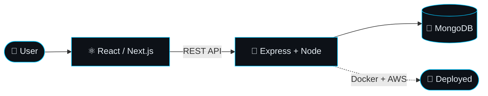
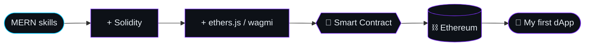
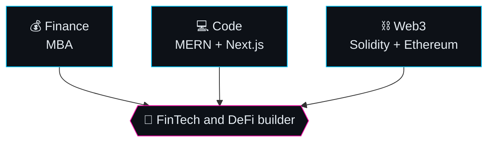

<div align="center">


### I build. I ship. Now I'm taking it on-chain. ✨
**MERN & Next.js Developer &nbsp;|&nbsp; Web3 Learner &nbsp;|&nbsp; MBA in Finance**

<p align="center">
  <a href="https://linkedin.com/in/mayur-bhil" target="_blank"></a>
  <a href="https://twitter.com/IamMayur_01" target="_blank"></a>
  <a href="mailto:mayurbhil47@gmail.com"></a>
</p>


<details>
<summary><b>🦊 &nbsp;Connect Wallet &nbsp;(click me)</b></summary>
<br />
✅ <b>Connected.</b> Gas fee: 0 ETH.<br/>
📍 <b>Location:</b> Surat, Gujarat, India<br/>
🎓 <b>Education:</b> MBA in Finance &nbsp;|&nbsp; BCA Graduate<br/>
💬 <b>Say hi:</b> <a href="https://linkedin.com/in/mayur-bhil">LinkedIn</a> · <a href="mailto:mayurbhil47@gmail.com">Email</a> · <a href="https://twitter.com/IamMayur_01">X</a>
</details>

</div>

---

## 👨‍💻 `$ about`

```solidity
// SPDX-License-Identifier: MIT
pragma solidity ^0.8.24;

contract Mayur {
    string public role       = "Full-Stack Developer, Web3 Learner";
    string public stack      = "MongoDB, Express, React, Node (MERN) + Next.js";
    string public learning   = "Solidity, Ethereum, smart contracts";
    string public studying   = "MBA in Finance";
    bool   public openToWork = true;   // freelance projects welcome

    function hire() external pure returns (string memory) {
        return "Let's build something great together.";
    }
}
```

I take an idea from database to deployment with the **MERN stack**, and I'm now learning **Web3** to build on-chain. My **MBA in Finance** adds the business side: money, markets and why FinTech and DeFi matter.

---

## ⚡ `$ my MERN stack`

| | Tech | What I do with it |
| :-: | :--- | :--- |
| **M** | **MongoDB** | Database design, schemas, queries |
| **E** | **Express** | REST APIs, middleware, authentication |
| **R** | **React** (and **Next.js**) | Fast, responsive UIs, state, server-side rendering |
| **N** | **Node.js** | Backend logic, real-time features, deployment |



Built with this stack: [**blinkit**](https://github.com/Mayur-Bhil/blinkit) (full-stack grocery app) and [**devTinder-app**](https://github.com/Mayur-Bhil/devTinder-app) (real-time chat and matching).

---

## ⛓️ `$ learning Web3`

| Phase | Focus | Status |
| :-: | :--- | :-: |
| **1** | Solidity fundamentals, Remix, testnets | 🟡 in progress |
| **2** | Hardhat or Foundry: build, test, deploy | ⚪ next |
| **3** | ERC-20 and ERC-721 with OpenZeppelin | ⚪ next |
| **4** | ethers.js / wagmi: connect a Next.js frontend | ⚪ next |
| **5** | IPFS storage and L2 deployment | ⚪ next |
| **6** | Ship a full dApp and open-source it | ⚪ goal |



Follow my progress in [**web3-things**](https://github.com/Mayur-Bhil/web3-things), where I learn in public.

---

## 🎓 `$ MBA in Finance + Code + Web3`



Finance teaches me how money and markets work. Code lets me build the product. Web3 is where the two meet. Together that is the kind of builder FinTech and DeFi teams need.

---

## ⛏️ `$ my journey, mined as a blockchain`

Every block below is **real SHA-256 proof-of-work**, and each block commits to the hash of the one before it. Change one word of my history and every hash after it breaks.

```math
H_n = \mathrm{SHA256}\left(n \,\|\, H_{n-1} \,\|\, \mathrm{data}_n \,\|\, \mathrm{nonce}_n\right), \qquad H_n \text{ must start with } 0000
```

| # | Block data | Nonce | Hash (SHA-256) | Prev |
| :-: | :--- | --: | :--- | :--- |
| **0** | Joined GitHub, 13 Aug 2023 | `76073` | `0000d7feff4250…` | `00000000…` |
| **1** | Learned the MERN stack | `95524` | `0000fcb259e417…` | `0000d7fe…` |
| **2** | Shipped blinkit, a full-stack grocery app | `13059` | `0000d03fea5e23…` | `0000fcb2…` |
| **3** | Built devTinder: real-time chat and matching | `42334` | `0000654b39f709…` | `0000d03f…` |
| **4** | Built g-docs: real-time collaborative docs | `2382` | `0000aab69871f2…` | `0000654b…` |
| **5** | Deployed a monorepo with Docker | `27072` | `0000e2e30cee29…` | `0000aab6…` |
| **6** | Started the Web3 journey: Ethereum and smart contracts | `29224` | `000066f36f4602…` | `0000e2e3…` |
| ⏳ | _Pending: deploy my first smart contract to a testnet_ | | _in the mempool_ | |
| ⏳ | _Pending: ship a full dApp, frontend to contract_ | | _in the mempool_ | |

<details>
<summary><b>🔍 Verify it yourself (Python, no dependencies)</b></summary>

<br />

```python
import hashlib

def block_hash(i, prev, data, nonce):
    return hashlib.sha256(f"{i}|{prev}|{data}|{nonce}".encode()).hexdigest()

# Block 0: genesis block, prev = 64 zeros
print(block_hash(0, "0" * 64, "Joined GitHub, 13 Aug 2023", 76073))
# -> 0000d7feff425090ad1139078cd1c32e608d09fc6811cdc16fb6391eca7d6588
```

Each next block uses the full hash of the previous block as `prev`. The table above shows the first 14 characters of each hash.

</details>

---

## 🚀 `$ projects`

| Project | What it does | Built with |
| :--- | :--- | :--- |
| [**blinkit**](https://github.com/Mayur-Bhil/blinkit) | Full-stack grocery e-commerce app: browse products, manage carts, secure checkout | MERN |
| [**devTinder-app**](https://github.com/Mayur-Bhil/devTinder-app) | Connect, chat in real time and build new friendships or professional networks | MERN |
| [**g-docs**](https://github.com/Mayur-Bhil/g-docs) | Real-time collaborative documents with a notification system | TypeScript |
| [**todo-app**](https://github.com/Mayur-Bhil/todo-app) | Monorepo deployment with Docker, a hands-on DevOps build | Docker, TypeScript |
| [**medium**](https://github.com/Mayur-Bhil/medium) | A full-stack blogging platform | TypeScript |
| [**web3-things**](https://github.com/Mayur-Bhil/web3-things) | My Web3 experiments and learning, in public | Web3 |

---

## 🛠️ `$ tech stack`

<div align="center">


<br /><br />

<br /><br />


</div>

---

## 💼 `$ services`

| | Service | What you get |
| :-: | :--- | :--- |
| **01** | **MERN Web Applications** | End-to-end apps with MongoDB, Express, React and Node.js |
| **02** | **Frontend and dApp UIs** | Fast React and Next.js interfaces, including wallet-connected frontends |
| **03** | **Performance Optimization** | Faster load times and smoother UX for apps you already have |
| **04** | **Cloud Deployment** | Docker, AWS and CI/CD to deploy and scale with confidence |

---

## 🐍 `$ live GitHub streak & snake`

<div align="center">

_These update automatically from my GitHub._

<br />


<br /><br />

<picture>
  <source media="(prefers-color-scheme: dark)" srcset="https://raw.githubusercontent.com/Mayur-Bhil/Mayur-Bhil/output/github-snake-dark.svg" />
  <source media="(prefers-color-scheme: light)" srcset="https://raw.githubusercontent.com/Mayur-Bhil/Mayur-Bhil/output/github-snake.svg" />
  
</picture>

</div>

---

## ❓ `$ faq`

<details>
<summary><b>What can you build for me?</b></summary>
<br />
Full-stack web apps with the MERN stack and Next.js, from the database and API to a fast, responsive frontend and deployment.
</details>

<details>
<summary><b>Do you work on Web3 projects?</b></summary>
<br />
I'm learning Solidity and Ethereum in public. The part I can already do well is the frontend and backend around a dApp, and I'm growing into the smart-contract side.
</details>

<details>
<summary><b>How do we start?</b></summary>
<br />
Send me your idea on <a href="https://linkedin.com/in/mayur-bhil">LinkedIn</a> or by <a href="mailto:mayurbhil47@gmail.com">email</a>. We agree on scope first, then I build in small steps so you see progress early.
</details>

---

<div align="center">

## 🚀 Let's build something great together 🚀

**[LinkedIn](https://linkedin.com/in/mayur-bhil)** &nbsp;·&nbsp; **[Email](mailto:mayurbhil47@gmail.com)** &nbsp;·&nbsp; **[X / Twitter](https://twitter.com/IamMayur_01)**


<sub>WAGMI · building in public, one block at a time ⛓️</sub>


</div>
